# 海外Yパパ 成長要因調査 最終報告書

- 対象：[海外Yパパラジオ 世界を読み解く](https://www.youtube.com/@海外Yパパ)（`UC8fTn4DsxlAlql3OXJ8syRA`）
- データ取得日：2026-10-19（UTC）
- 調査範囲：公開中の全351本（通常動画350・Shorts1・ライブ0）、代表37本の字幕と映像、類似3チャンネル
- 表記：【事実】はデータで確認できたこと、【推論】はデータからの解釈、【仮説】は公開データで検証しきれないもの
- 詳細な集計表：[phase2_tables.md](phase2_tables.md)・[phase4_tables.md](phase4_tables.md)・[thumbnail_tables.md](thumbnail_tables.md)、作業記録：[docs/overseas-y-papa-progress.md](../../docs/overseas-y-papa-progress.md)

---

## 1. 調査概要と主要な結論

### 問い

海外Yパパは、なぜ成長したのか
そのうち、どの要因が他のYouTubeチャンネルにも再現可能なのか

### 成長の事実

- 【事実】初投稿 2026-02-12、約8か月で登録者16.7万人・総再生4,157万回
- 【事実】2026-06-10 に3.32万人・総再生501万回 → 10-19 に16.7万人・4,157万回（131日で登録者+13.4万人、1日あたり約1,020人）
- 【事実】比較した3チャンネル（大人の学び直しTV・ジオグラ・ゆるコンピュータ科学ラジオ）の開設後8か月時点より速いか同等（[図10](charts/10_peers_growth.png)）

### 結論（要約）

成長は「1本ごとの再生の底上げ」と「周期的なヒット」の掛け算で説明できる

1. **量と型**：低コストで再現できる制作の型（猫アバター＋街歩き映像＋図表カード＋常時字幕、10〜20分）で、1日1.2〜1.7本を毎朝6時中心に投稿し続けた
   - 比較チャンネルの7〜24倍の投稿頻度
   - 1本あたり再生中央値は 4.9万 → 8.3万 → 9.6万 → 12.2万回と期間ごとに上昇
2. **題材の選び方**：海外・AI・経済の話題を「日本の視聴者にとってどうか」に置き換え、特に国際比較・ランキングと「日本は思われているより悪くない」という安心させる逆張りで、相対再生指数が平均の2〜3倍になる
   - 国際比較・ランキング型：中央値の比 1.82倍（補正後 p=0.001）
   - 日本に肯定的・安心させる論調：中央値 2.45、否定的な論調 1.04（p=0.005）
3. **信頼の作り方**：富裕層の資産防衛とAI開発の実務者という一人称の立場、煽らない語り口、視聴者コメントを次の題材にする運営で、比較チャンネルより高評価率が1.6〜2.1倍、コメント率が2.2〜5倍高い

一方で、次は動画ごとの差を説明しなかった

- タイトルの疑問符・数字・【】・文字数（いずれも差なし）
- サムネイルの色・明度・文字量（テンプレート化されて差がない）
- 冒頭の構成（チャンネル紹介の位置・登録依頼の位置はどの群も同じ）
- 時事性（ニュース起点かどうかでは差なし）

### 他チャンネルへの再現可能性

| 要因 | 再現可能性 | 理由 |
|---|---|---|
| 国際比較・ランキング型の企画 | 高 | 題材の切り方の問題で、出演者の属性に依存しない |
| 視聴者の国・立場に引き寄せる再構成 | 高 | どの国・業界向けにも置き換えられる |
| 通説への反論を数値で示す | 中〜高 | データ収集の手間がかかるが方法は一般的 |
| 低コストの制作テンプレートと定時の高頻度投稿 | 中 | 型は真似できるが、1日1本以上の台本を書く能力（または AI 支援）が必要 |
| 実務者としての一人称の信頼 | 低〜中 | 本人の経歴に依存する |
| 寸劇・歌などのエンタメ回 | 再現すべきでない | このチャンネルでは一貫して低実績 |

---

## 2. チャンネルの成長過程

### 2.1 登録者数と総再生数

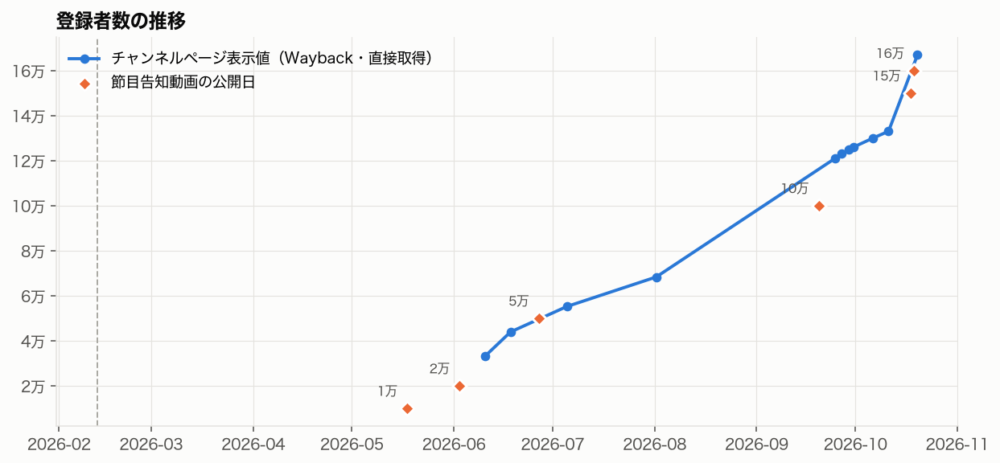

| 観測日 | 登録者 | 公開動画数 | 1日あたり増加 | 出典 |
|---|---|---|---|---|
| 2026-05-17 | 1万（告知） | — | — | [登録者1万人の告知動画](https://www.youtube.com/watch?v=b9ye8NUSjm0) |
| 2026-06-02 | 2万（告知） | — | — | [「たった2週間」2万人告知](https://www.youtube.com/watch?v=B2ZrpsG9ryU) |
| 2026-06-10 | 33,200 | 208 | — | Wayback |
| 2026-06-17 | 43,900 | 219 | 1,389 | Wayback |
| 2026-07-04 | 55,200 | 251 | 660 | Wayback |
| 2026-08-01 | 68,300 | 295 | 483 | Wayback |
| 2026-09-24 | 121,000 | 307 | 969 | Wayback |
| 2026-10-10 | 133,000 | 336 | 約740（09-24から） | Wayback |
| 2026-10-19 | 167,000 | 351 | 3,863 | 直接取得 |

- 【事実】登録者数の値はチャンネルページの表示値（3桁に丸め）
- 【事実】2026-06-10 より前は外部統計サイトが取得できず、節目告知動画のタイトル（自己申告）しかない
- 【事実】2026-03-16〜03-26 の10日間は投稿がなく、[「（復活）このチャンネルが詐欺扱いされ吹っ飛びました」](https://www.youtube.com/watch?v=_MhmDIUKVzs) によるとチャンネル停止期間

### 2.2 急増期間と、その期間に公開された動画

| 区間 | 1日あたり登録者増 | 区間内で最も再生された動画 |
|---|---|---|
| 06-10→06-17 | 1,389 | 06-06 [AIの回答が日本に執着することが英国の論文で判明](https://www.youtube.com/watch?v=VnxoCYMflwo)（107万回、相対指数12.8）の直後 |
| 06-17→07-04 | 660 | [オーストラリアの大学から中国人留学生が消えている理由](https://www.youtube.com/watch?v=ZLGNFIetycw)（52万回） |
| 08-01→09-24 | 969 | [人口統計マニアの僕が語る少子化の理由](https://www.youtube.com/watch?v=_lSsXr0jFQ4)（71万回）、[ロボット大国日本。なぜ人型に参戦しない？](https://www.youtube.com/watch?v=AzOegsFw1ZM)（61万回） |
| 10-10→10-19 | 3,863 | 10-14 [ハッカーホイホイ作ったら48時間で1万回来た](https://www.youtube.com/watch?v=a77m_WSa93A)（公開5.6日で244万回、全動画で最多） |

- 【事実】最大の急増区間（9日で+3.4万人）は全動画最多の再生数の動画の公開直後
- 【推論】急増はヒット動画1本による段階的な跳ね上がりで説明できる
- 【事実】一方、再生は特定動画に集中していない：上位1本で全体の5.7%、上位10本で17.7%
- 【事実】外部報道やテレビ出演の記録は検索で見つからなかった（Web検索の範囲）
  - 最大ヒットの一つ「AIが日本に執着」は、ITmedia が [2026-04-30](https://www.itmedia.co.jp/news/articles/2604/30/news025.html) に報じた論文を約5週間後に扱ったもので、速報ではない

### 2.3 投稿本数と1本あたり再生数の推移

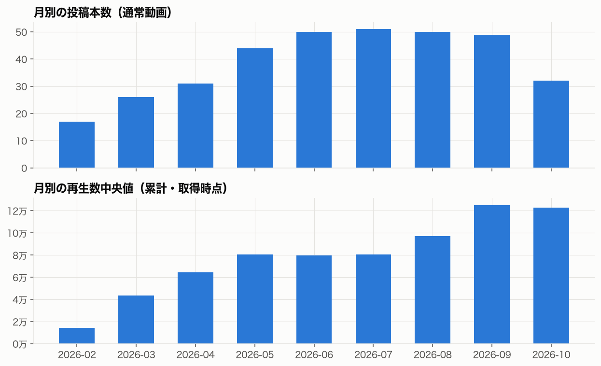

| 期間（登録者の節目で区切る） | 開始 | 本数 | 投稿日あたり本数 | 尺中央値 | 再生中央値 | 相対指数2倍以上の割合 |
|---|---|---|---|---|---|---|
| P1 〜1万 | 02-12 | 100 | 1.20 | 9.8分 | 49,162 | 22% |
| P2 1万〜5万 | 05-17 | 60 | 1.46 | 15.5分 | 82,797 | 15% |
| P3 5万〜10万 | 06-26 | 137 | 1.59 | 14.5分 | 96,383 | 19% |
| P4 10万〜 | 09-19 | 53 | 1.71 | 12.4分 | 121,695 | 22% |

- 【事実】250日中238日に投稿し、うち107日は1日2本以上
- 【事実】ヒット率（相対指数2倍以上）は各期間でほぼ一定（15〜22%）
- 【推論】成長は「ヒット率の上昇」ではなく、「底上げされた1本あたり再生 × 増え続ける本数 × 一定の確率で出るヒット」の積

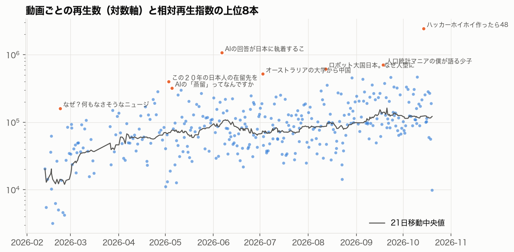

### 2.4 テーマの時系列変化

| 期間 | 最多テーマ | 構成比の特徴 |
|---|---|---|
| P1 | 人口・社会・教育 22%、海外生活 20%、国際情勢 19% | NZ移住・教育のローカル話題が中心、尺5〜8分、ハッシュタグ多用 |
| P2 | AI・テック解説 42%、AI実務 13% | AI話題に大きく振れる |
| P3 | 経済・金融・投資 38% | 経済・国際比較へ |
| P4 | 経済 25%、AI 17%、サイバー 13% | 雑談・告知・音楽も15%に増える |

- 【事実】初期のNZローカル回は低実績が多い（相対指数の下位15本中5本がP1のNZ関連、豪州を含めると6本）
- 【推論】「海外在住者の生活紹介」から「海外視点で日本の視聴者の関心事を解説する」への転換が、伸び始めと重なる

---

## 3. テーマ・タイトル・サムネイルの分析

### 方法

- 【事実】公開時期の差を補正するため「相対再生指数」を使う：その動画の再生数 ÷ 前後10本（同種別）の再生数中央値
  - 1.0 が「その時期の標準」、2.0 が標準の2倍
- 公開7日未満は除外し、雑談・告知・音楽（Z）を除いた305本で比較
- 公開後7日・30日の再生数は公開データにない
  - Wayback の動画一覧から復元できた範囲では、公開7〜14日時点の再生数は現在の約49%（n=42）
  - 相対指数は「初速」ではなく「現在までの累計の相対値」

### 3.1 テーマ

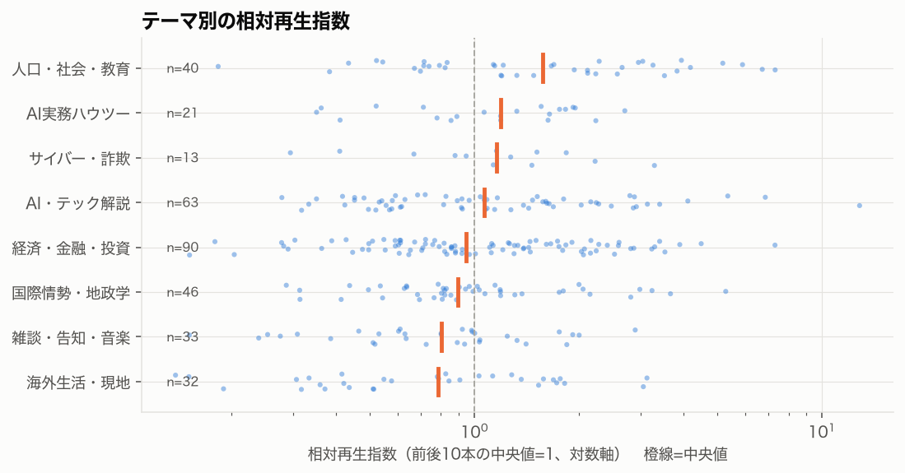

| テーマ | 本数 | 相対指数中央値 |
|---|---|---|
| 人口・社会・教育 | 40 | 1.57 |
| AI実務ハウツー | 21 | 1.19 |
| サイバー・詐欺 | 13 | 1.16 |
| AI・テック解説 | 63 | 1.07 |
| 経済・金融・投資 | 90 | 0.94 |
| 国際情勢・地政学 | 46 | 0.90 |
| 雑談・告知・音楽 | 33 | 0.80 |
| 海外生活・現地 | 32 | 0.78 |

- Kruskal-Wallis p=0.005
- 【事実】最も本数の多い経済（90本）は中央値1.0未満で、本数とテーマの強さは一致しない
- 【事実】AI実務は重回帰でも経済比1.82倍（p=0.001）だが、P4 ではゼロ本になっている

### 3.2 内容の特徴（手作業コーディング）

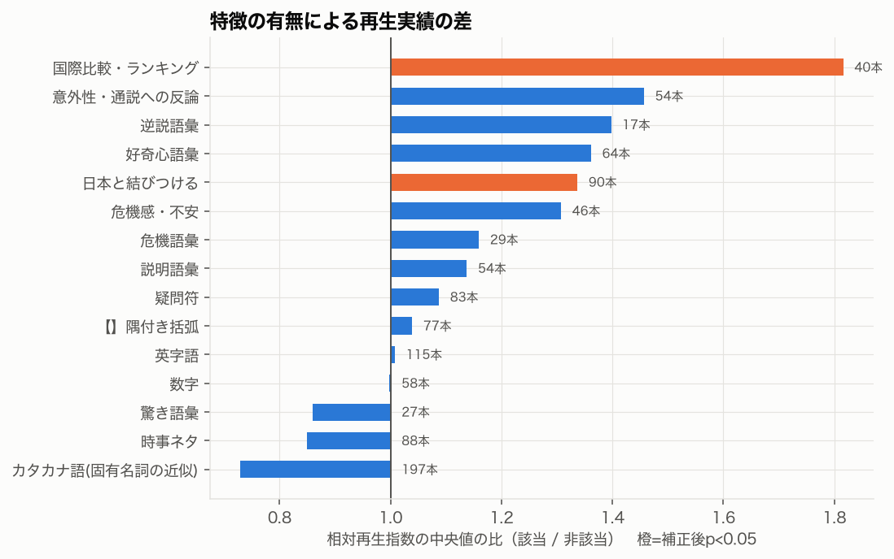

| 特徴 | 該当本数 | 中央値の比 | 補正後p | 重回帰の倍率（p） |
|---|---|---|---|---|
| 国際比較・ランキング | 40 | 1.82 | 0.001 | 1.55（0.002） |
| 日本と結びつける | 90 | 1.34 | 0.004 | 1.39（0.001） |
| 意外性・通説への反論 | 54 | 1.46 | 0.099 | 1.37（0.015） |
| 危機感・不安 | 46 | 1.31 | 0.381 | 1.27（0.077） |
| 時事ネタ | 88 | 0.85 | 0.990 | 1.23（0.069） |

- 重回帰：目的変数 log2(相対指数)、テーマ・期間・尺・投稿時間帯を同時に調整、n=305、調整済みR²=0.16、HC3標準誤差
- 【事実】R²=0.16 であり、題材の特徴で説明できるのは再生差の一部

#### 日本への言及の論調

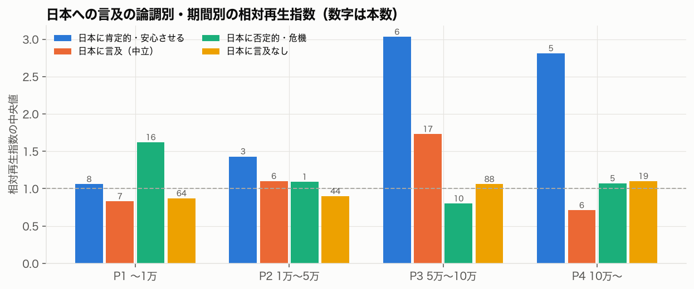

| 論調 | 本数 | 中央値 | 例 |
|---|---|---|---|
| 日本に肯定的・安心させる | 22 | 2.45 | [「日本はGDPが下がった」だから何？に答えます](https://www.youtube.com/watch?v=qvqh45gkXl0)（4.49）、[なぜ日本人は世界的に最も騙されにくいのか](https://www.youtube.com/watch?v=rieQKw3T2GQ)（4.18）、[日本の好感度は世界３位](https://www.youtube.com/watch?v=4WW2RSu9gps)（3.66）、[実は日本の少子高齢化は世界でもトップレベルでマシ](https://www.youtube.com/watch?v=AqZ5aLoqz9E)（3.82） |
| 日本に言及（中立） | 36 | 1.29 | [日本はどの国にお金を貸していて…](https://www.youtube.com/watch?v=K5X_QXgjxyU)（3.53） |
| 日本に否定的・危機 | 32 | 1.04 | — |
| 日本に言及なし | 215 | 0.92 | — |

- 肯定 vs 否定 p=0.005、肯定 vs 中立 p=0.046
- 【事実】P1 では否定的な論調（日本の教育批判など）のほうが高く（1.62）、肯定的な論調の優位は P3・P4 で顕著（3.03・2.81）
- 【反証】日本関連でも低い回がある：[中国の教科書では北方領土は誰のもの？](https://www.youtube.com/watch?v=tB3k_JOFTx4)（0.29）、[トヨタに並んだ電池屋のCATL](https://www.youtube.com/watch?v=L8xaqI_2rvI)（0.29）
- 【限界】論調のコーディングは再生数を知った状態で1名が行ったため、判定が実績に引きずられた可能性がある

#### 国際比較・ランキング型の例

| 動画 | 相対指数 |
|---|---|
| [この２０年の日本人の在留先を振り返る。１位はアメリカ、２位は中国じゃないよ](https://www.youtube.com/watch?v=eEQWH3nQjGI) | 6.72 |
| [【日本まだマシ？】少子高齢化レース、アジア大会！！](https://www.youtube.com/watch?v=LCW-w4k9_DU) | 3.26 |
| [【世界借金レース】結局一番ヤバい国は？](https://www.youtube.com/watch?v=iRa7RrkvtLA) | 2.41 |
| [先進国が集まってサウナ大会！最初にギブアップはどの国？](https://www.youtube.com/watch?v=VnGKY89VUQM) | 2.36 |
| [【デッドヒート！】汚職激戦区の東南アジアで一番カネに汚い国は？？](https://www.youtube.com/watch?v=7zTwv_WAyrk) | 2.15 |
| 反例：[【中二病】世界の高校生が「授業中にする妄想」を8カ国で比較](https://www.youtube.com/watch?v=6BVR8Hm39L4) | 0.73 |
| 反例：[【香ばしく競争】約束を破りまくる国コンテスト！](https://www.youtube.com/watch?v=ScC3Q-CI_9c) | 1.18 |

### 3.3 タイトル

| 要素 | 該当本数 | 中央値の比 | 補正後p |
|---|---|---|---|
| 疑問符 | 83 | 1.09 | 0.71 |
| 数字 | 58 | 1.00 | 0.99 |
| 【】隅付き括弧 | 77 | 1.04 | 0.99 |
| 好奇心語彙（理由・正体・なぜ等） | 64 | 1.36 | 0.07 |
| 逆説語彙（実は・じゃない・マシ等） | 17 | 1.40 | 0.38 |
| 驚き語彙 | 27 | 0.86 | 0.99 |

- 文型（疑問形・断定形・説明形）：p=0.53、文字数：p=0.74
- 【事実】形式的なタイトル技法では差が出ない
- 【推論】タイトルで効いているのは書き方ではなく、何を（日本・国際比較・通説の否定）約束しているか
- 【事実】比較チャンネルは疑問符を49〜87%で使う（海外Yパパは20%）。疑問形は差別化要因ではない

### 3.4 サムネイル

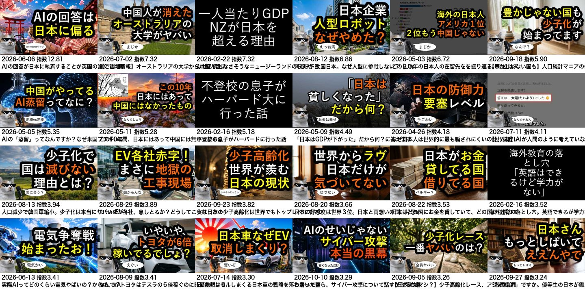
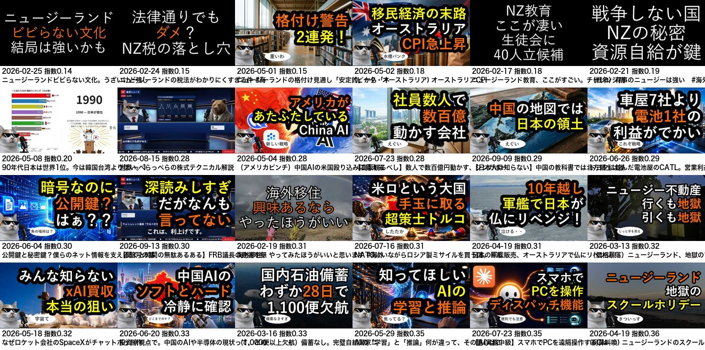

- 【事実】2月の初期は黒地に白文字のみ。2月末以降は「サングラスの猫アバター（左下）＋写真またはAI生成風の背景＋白縁取りの黄・橙・白の大きな文字2〜3行＋吹き出しの一言」に固定（[月別の変遷](thumbnails/by_month.jpg)）
- 【事実】明度・彩度・色量・エッジ密度・黄色比率など9指標は、上位20%と下位20%で差なし（補正後p≥0.22、[表](thumbnail_tables.md)）
- 【事実】目視では、サムネ文字に「日本」を含む割合が上位24本で50%、下位24本で12.5%
- 【事実】タイトルとの役割分担：サムネはタイトルの結論部分を8〜15字に言い換える（例：タイトル「AIの回答が日本に執着することが英国の論文で判明…」→サムネ「AIの回答は日本に偏る」）
- 【事実】比較チャンネルも「太い縁取り文字＋黄・赤の強調＋写真背景」で、この様式はジャンル共通（[ジオグラ](thumbnails/peer_peer-geogra.jpg)・[大人の学び直しTV](thumbnails/peer_peer-otona-manabinaoshi.jpg)・[ゆるコンピュータ科学ラジオ](thumbnails/peer_peer-yurucom.jpg)）
- 【推論】デザインは一定に保たれ、クリックの差は文字の内容（何の話か）で生じている
- 【仮説】猫アバターの一貫性はチャンネルの識別（再訪）に効いている可能性があるが、公開データでは検証できない

---

## 4. 動画尺・投稿戦略の分析

### 4.1 動画尺

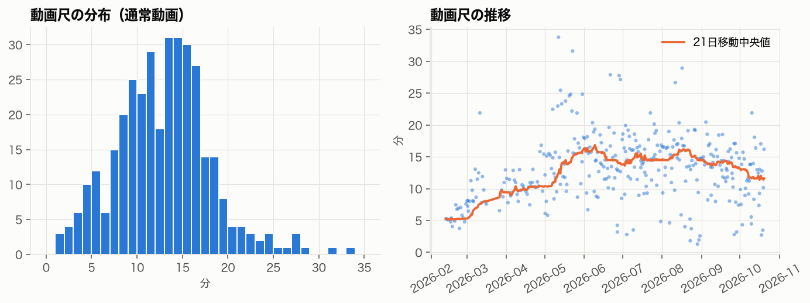
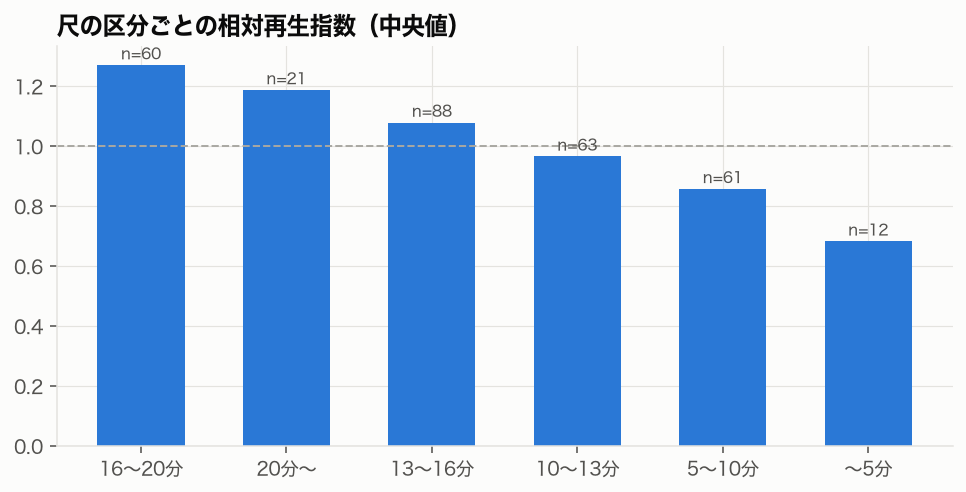

| 尺 | 本数 | 相対指数中央値 |
|---|---|---|
| 〜5分 | 12 | 0.68 |
| 5〜10分 | 61 | 0.86 |
| 10〜13分 | 63 | 0.97 |
| 13〜16分 | 88 | 1.08 |
| 16〜20分 | 60 | 1.27 |
| 20分〜 | 21 | 1.19 |

- Kruskal-Wallis p=0.008、重回帰で1分あたり+3.2%（p=0.004）
- 【事実】尺は P1 の5〜8分から P2 で15分前後に伸び、P4 では12分前後
- テーマ別平均：経済15.0分、サイバー16.5分、AI 14.4分、人口・社会10.3分、海外生活8.7分
- 【推論】長尺ほど高い傾向は、総再生時間を重視する推薦との整合が考えられるが、短尺に寸劇・告知・初期のNZ話題が多い交絡もある
- 【限界】視聴維持率・平均視聴時間は公開データにないため、「長いから見られた」のか「見られる題材が長くなった」のかは判別できない

### 4.2 投稿頻度・時間帯・曜日

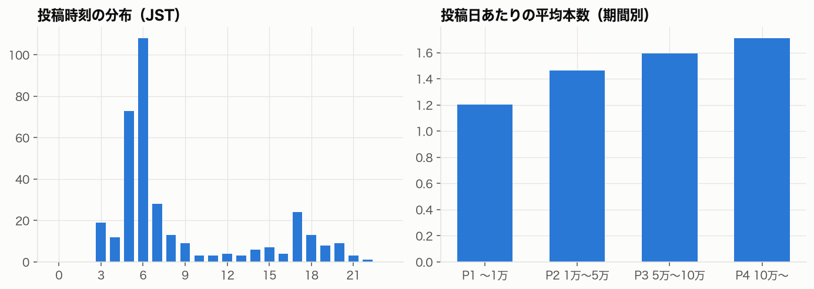

- 【事実】朝6〜7時台（JST）の投稿比率：P1 16% → P2 23% → P3 55% → P4 58%
- 【事実】朝6〜7時台の動画は中央値1.19、その他の時間0.92。ただし重回帰で期間・テーマを調整すると有意でない（1.13倍、p=0.26）
- 【事実】曜日による差はない（p=0.20）
- 【事実】P3・P4 の朝の動画で、同日に他の投稿がある場合は中央値0.88（62本）、単独の日は1.38（37本）
  - 【推論】同日の追加投稿が朝の動画の再生を食い合っている可能性がある
  - 【代替説明】追加投稿が「朝の題材が弱い日」に行われた可能性、雑談系の追加投稿が多い日の偏り

### 4.3 シリーズ・型

| 型 | 本数 | 初出 | 相対指数中央値 |
|---|---|---|---|
| コンテスト・レース型 | 10 | 06-02 | 1.49 |
| 「わかったから〜について話すから落ち着けって」 | 3 | 07-30 | 2.07 |
| 資産防衛 | 4 | 04-18 | 1.26 |
| AI実務（中級など） | 7 | 06-24 | 1.19 |
| ゆる○○（雑談・訪問・紹介） | 17 | 04-14 | 0.98 |
| ラップバトル | 3 | 08-28 | 0.83 |
| Yパパシュラン（グルメ） | 2 | 09-11 | 0.67 |

- 【事実】登録者節目の告知・音楽・寸劇（Z）は中央値0.80。[ニャーレンジャー オープニングMV](https://www.youtube.com/watch?v=IolaBk9OR-A)（0.15）、[15万人](https://www.youtube.com/watch?v=1jNuQGYWORc)・[16万人](https://www.youtube.com/watch?v=GBtKhSbUq6A)告知（0.33・0.31）
- 【推論】シリーズ化は成長の主因ではない。効いているのは「国同士を競わせる型」という企画の型で、シリーズ名ではない

### 4.4 エンゲージメント

- 【事実】高評価率と相対指数は負の相関（Spearman -0.60）。相対指数の上位20%は高評価率2.1%、下位20%は3.7%
- 【推論】ヒット動画は既存の視聴者以外（推薦経由の新規視聴者）に届いており、新規層は高評価を押しにくい
- 【限界】トラフィック元（ブラウジング・関連動画・検索）は公開データにないため確認できない

---

## 5. 動画構成・映像表現・ナレーションの分析

### 方法

- 相対指数の上位20%・40〜60%・下位20% から、期間（P1〜P4）×3本、同じ期間でテーマが重複しないよう各12本を自動選定（[選定結果](../../data/overseas-y-papa/processed/phase3_sample.csv)）
- P4 の下位は候補が2本しかなく、P1 から1本補充
- 最大ヒットの [ハッカーホイホイ](https://www.youtube.com/watch?v=a77m_WSa93A) は公開7日未満のため選定外となり、参考事例として追加（計37本）
- 字幕（YouTube自動字幕）で話速・定型句の位置を自動計測し、全文の要約を読んで構成を手作業でコーディング（[基準](../../docs/overseas-y-papa-codebook.md)、[結果](../../data/overseas-y-papa/annotations/phase3_coding.csv)）
- 映像は360p で一時取得し、15秒ごとのフレームとカット検出だけ残して削除。全37本のフレーム一覧を目視確認

### 5.1 構成の型（チャンネル共通）

【事実】P2 以降のほぼ全ての解説回が次の型をとる

| 区間 | 内容 | 典型的な時刻 |
|---|---|---|
| 冒頭の掴み | 数字・実験・ニュース・視聴者コメントで問いを立てる | 0:00〜0:30 |
| チャンネル紹介 | 「海外Yパパラジオ。皆様How are you？…今はシンガポールに家族で住んでいます」 | 中央値 27〜41秒 |
| 立場表明・構成予告 | 「煽ってビューを取る感じではない」「大きく3つに分けて話します」 | 1:00〜2:00 |
| 本編 | 仕組み → 数値 → 日本への影響 | — |
| 終盤 | 「最初の問いに戻ります」→ 結論の言い換え | 最後の1〜2分 |
| 定型の締め | 「この動画が気に入ったら高評価、チャンネル登録お願いします。コメント全部読ませてもらっています」 | 最後の30秒 |

#### 構成のタイムライン（全37本）

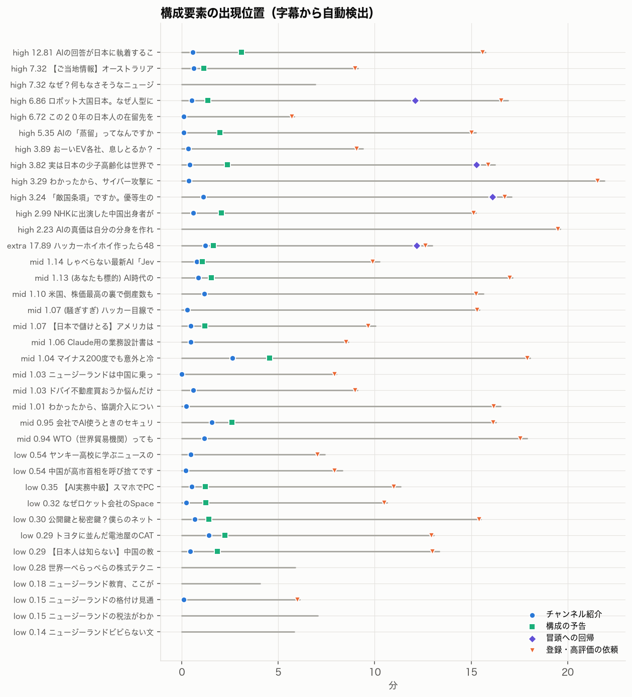

代表例：[ハッカーホイホイ作ったら48時間で1万回来た](https://www.youtube.com/watch?v=a77m_WSa93A)（244万回）

| 時刻 | 区間 |
|---|---|
| 0:00 | 「観察1日目」ダッシュボード画面から始まる |
| 0:10 | ハッカー像のステレオタイプを提示し「野生の姿を見たい」 |
| 0:30 | 実験の設定（初期パスワードのままの見守りカメラに偽装したPCを48時間放置） |
| 0:50 | 「皆さんの家のパソコンやカメラも24時間さらされている」と視聴者に引き寄せる |
| 1:05 | チャンネル紹介 |
| 2:00 | 実験の作り方 |
| 4:00 | 最初のノックまでの時間（国別） |
| 5:00 | 「寄ってくる生き物図鑑」（攻撃の種類） |
| 7:00 | 乗っ取りの瞬間 |
| 9:00 | 2016年の Mirai 事件 |
| 11:00 | 「攻撃は選ばれた家に来るのではなく、開いている家に来る」 |
| 12:00 | 対策（初期パスワードの変更） |
| 12:30 | 冒頭の問いに戻る → 定型の締め |

### 5.2 群間比較

| 項目 | 高（12本） | 中（12本） | 低（12本） | 判定 |
|---|---|---|---|---|
| 話速（字幕の文字数/分） | 327 | 333 | 333 | 差なし |
| チャンネル紹介の時刻（中央値） | 28秒 | 41秒 | 27秒 | 差なし |
| 終盤60秒に登録・高評価の依頼 | 11/12 | 12/12 | 8/12 | 低群の欠落は初期P1の回 |
| 構成予告（手作業） | 9/12 | 5/12 | 4/12 | 自動検出では 5/12・4/12・5/12 で差なし → 判定保留 |
| 冒頭への回帰（手作業／自動） | 4/12 ／ 3/12 | 2/12 ／ 0/12 | 2/12 ／ 0/12 | 高群にやや多い（少数） |
| 数値データの密度「高」（手作業） | 8/12 | 5/12 | 1/12 | 高群に多い |
| 本編で日本への影響に触れる | 10/12 | 6/12 | 8/12 | 低群は寸劇・NZ回が日本に触れるため単純比較できない |
| 寸劇形式 | 0 | 0 | 3 | 低群のみ |
| 初期の自宅vlog映像 | 1 | 1 | 3 | 低群に多い |

- 【事実】型（冒頭の掴み → 紹介 → 本編 → 定型の締め）は群に関係なく共通
- 【推論】型そのものは動画間の差を生まない。型はチャンネル全体の底上げ（安定した視聴体験）に寄与している可能性はあるが、公開データでは検証できない
- 【事実】高群と同じ型・同じ映像・日本への言及があっても低い回がある：[なぜロケット会社のSpaceXがxAIを買ったのか？](https://www.youtube.com/watch?v=RZEYi49qR54)（0.32）、[CATL](https://www.youtube.com/watch?v=L8xaqI_2rvI)（0.29）、[北方領土](https://www.youtube.com/watch?v=tB3k_JOFTx4)（0.29）
  - 【推論】これらは「外国企業や外交の出来事の解説」で、日本の視聴者自身が得をする・安心する結論になっていない

### 5.3 映像表現

- 【事実】P2 以降の解説回の映像は、群に関係なく次の組み合わせ
  - 背景：シンガポール（以前はNZ）の街歩き・車窓・ホーカーセンターの実写映像。内容とは直接関係しない環境映像
  - 左下にサングラスの猫アバターとマイクが常駐
  - 下部に全文の字幕を常時焼き込み
  - 1〜2分ごとに「大きな数字1つ＋説明1行」の黒い角丸カード（例：「8つ中6つで日本」「約660万件」）
  - ときどき手描き風の三毛猫イラスト（比喩の図解）
- 【事実】例外：[在留先の回](https://www.youtube.com/watch?v=eEQWH3nQjGI) はバーチャートレースの図解のみ、[サイバー攻撃の回](https://www.youtube.com/watch?v=bmmF1tUwnt8) はスライド型インフォグラフィック、ハッカーホイホイは自作ダッシュボード
- 【事実】カット検出（ffmpeg のシーン変化0.3以上）は解説回で毎分2.8回程度。スライドのフェード切替を検出できないため、映像のテンポ比較には使えなかった
- 【事実】低群に特有なのは、AI生成と見られるキャラクター寸劇（[黒猫君のバイト](https://www.youtube.com/watch?v=UQpqL53HNkU)・[ヤンキー高校](https://www.youtube.com/watch?v=eiTu1ppCYF8)・[経済ニュースのパロディ](https://www.youtube.com/watch?v=-SLnwegX0Y4)）と、初期の自宅映像
- 【推論】映像は「聞き流せるラジオに字幕と要点カードを添えた」水準で、視覚情報の作り込みは差の要因ではない。映像の作り込みを抑えたことが、1日1本以上の制作を可能にしていると考えられる

### 5.4 ナレーション

- 【事実】話速は全群で毎分約330字（字幕ベース）
- 【事実】語り口：一人称「僕」、標準語に関西弁の崩し（「やれんのか」「ちゃうで」「やねん」）、比喩とツッコミ（「泥棒が泥棒を」「稲子タワー」）
- 【事実】立場表明を繰り返す：「現役で超富裕層の資産管理をしている」「AIを開発する会社をやっていた」「作る側にいた人間として慎重に話したい」「煽ってビューを取る感じではない」
- 【事実】視聴者コメントを題材にする回が多い（サイバー攻撃・NZと中国・ドバイ不動産・宇宙の放熱）。宇宙の放熱の回では、前回動画の誤りを視聴者の指摘で認めて計算し直している
- 【推論】専門用語は「猫と魚」「包丁」「大工」などの比喩で言い換え、聞き流しても筋が追えるように作られている
- 【限界】これらはチャンネル内でほぼ一定のため、動画間の差の要因かは検証できない。比較チャンネルとの違いとしては6章で扱う

---

## 6. 類似チャンネルとの比較

### 選定根拠

- 海外Yパパの高実績テーマから作った検索語10個（「少子化 理由 解説」「中国経済 解説」「AI 最新 ニュース 解説」など、[一覧](../../config/channels/overseas-y-papa.peers.toml)）で YouTube 検索上位30件を取得
- 報道機関・大手メディア・著名人チャンネルを除き、複数の検索語に出現した個人系の解説チャンネルを選んだ

| チャンネル | 出現した検索語 | 選定理由 |
|---|---|---|
| [大人の学び直しTV](https://www.youtube.com/channel/UCNJRaN9NIAbCXpDa_hAKd3g) | 6/10 | 経済・国際情勢の解説、顔出しなしのナレーション |
| [ジオグラ【ゆっくり雑学】](https://www.youtube.com/channel/UCWX0rU4o9CR8nUJKz0bSMlQ) | 3/10 | 国・地理の比較、合成音声とキャラクター |
| [ゆるコンピュータ科学ラジオ](https://www.youtube.com/channel/UCpLu0KjNy616-E95gPx7LZg) | 2/10 | 「ラジオ」形式、テック・サイバーを扱う |

### 比較（各チャンネルの直近40本の通常動画、公開7日以上）

| 指標 | 海外Yパパ | 大人の学び直しTV | ジオグラ | ゆるコンピュータ科学ラジオ |
|---|---|---|---|---|
| 登録者 | 16.7万 | 107万 | 17.1万 | 57.9万 |
| 開設（投稿開始） | 2026-02 | 2019-01 | 2023-05 | 2021-12 |
| 週あたり投稿 | **12.7** | 1.7 | 0.5 | 1.0 |
| 尺中央値 | **12.1分** | 25.2分 | 20.4分 | 41.8分 |
| 再生中央値 | 11.9万 | 17.3万 | 13.9万 | 39.0万 |
| 再生中央値／登録者 | 0.71 | 0.16 | 0.81 | 0.67 |
| 最大／中央値 | 3.9 | 5.5 | 11.6 | 2.5 |
| 高評価率 | **2.56%** | 1.21% | 1.29% | 1.64% |
| コメント率 | **0.41%** | 0.10% | 0.08% | 0.19% |
| タイトルに「日本」 | **33%** | 18% | 6% | 3% |
| タイトルに疑問符 | 20% | 87% | 84% | 49% |
| 朝6〜7時台の投稿 | **60%** | 0% | 0% | 0% |
| Shorts（全期間） | 1本 | 40本以上 | 0 | 0 |

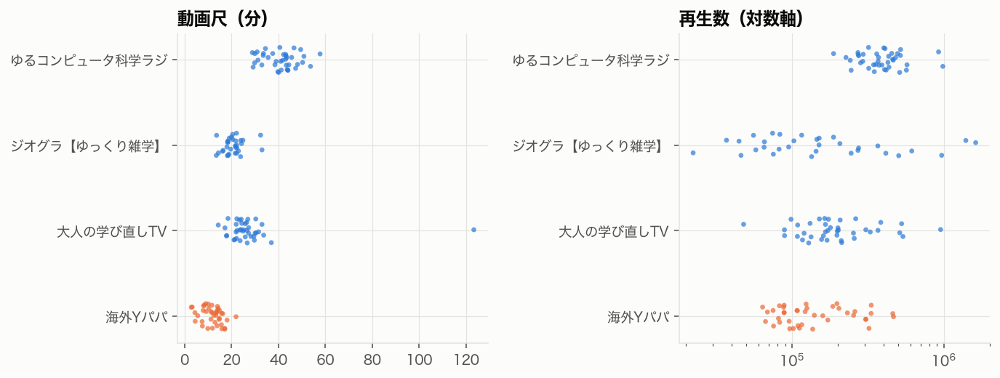
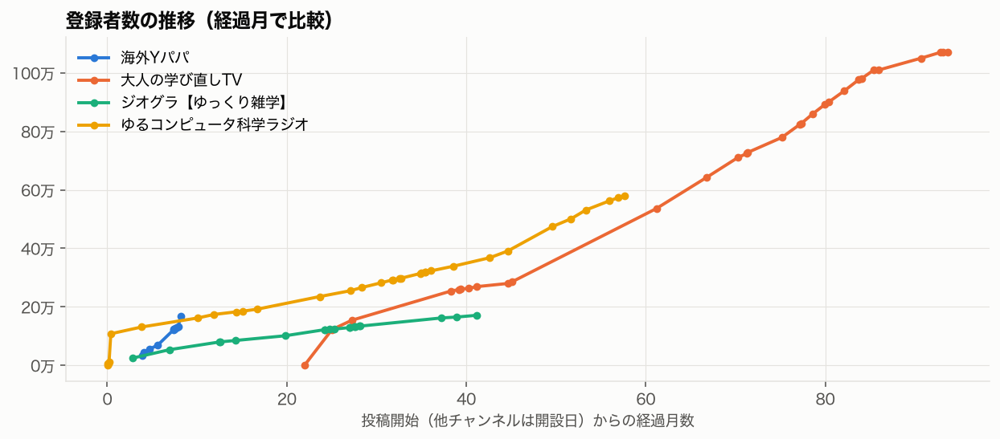

- ジオグラはメンバー限定の5本を取得できず32本で比較
- Wayback の過去値には、保存時のページが古い登録者数を表示している異常値がある（例：ゆるコンピュータ科学ラジオ 2022-10-27 の4.35万人。前後は13.1万・16.2万人）。過去最大値の7割未満に急減した観測は異常値として除外した（[一覧](phase4_tables.md)）

### 構成・映像・ナレーション（各3本：直近40本の再生上位・中央・下位）

| | 海外Yパパ | 大人の学び直しTV | ジオグラ | ゆるコンピュータ科学ラジオ |
|---|---|---|---|---|
| 話者 | 1人（本人の声、猫アバター） | 1人（丁寧語のナレーション） | 合成音声2人の掛け合い | 2人の対談（顔出し） |
| 冒頭 | 数字・実験・ニュースの問い → 30秒前後で紹介 | 挑発的な問い → 即答「答えはノーです」 → 45秒で登録依頼 | 謎の提示（湖が消えた） | お題の提示 → 即答 → 雑談 |
| 映像 | 街歩きの環境映像＋数字カード | 地図・図解・写真の密な編集 | 地図・衛星写真・資料写真 | スタジオ映像＋テロップ |
| 締め | 定型の高評価・登録依頼 | 著書の宣伝 | メンバーシップ告知 | 雑談で終わる |
| 時事性 | 高い（直近のニュース起点が多い） | 高い | 低い（歴史・地理の常緑） | 中 |

### ジャンル共通の特徴と、海外Yパパ固有の特徴

| | 特徴 |
|---|---|
| ジャンル共通 | 冒頭で問いを立てて答えを予告する構成、顔出しなしの解説、太い縁取り文字と黄・赤強調のサムネ、国際比較・地理の題材、15分以上の尺 |
| 海外Yパパ固有 | 週12本超の投稿量、毎朝6時の定時、12分前後の短めの尺、制作コストの低い映像、タイトルと結論を日本の視聴者に引き寄せる比率の高さ、一人称の実務者としての語り、比較チャンネルより高い高評価率（1.6〜2.1倍）とコメント率（2.2〜5倍） |

- 【推論】海外Yパパの独自性は「型」ではなく、「量 × 日本への引き寄せ × 当事者の語り」の組み合わせにある
- 【推論】最大／中央値が3.9とジオグラ（11.6）より小さく、再生のばらつきが小さい。一発のヒット依存ではなく、平均的な回の安定感で積み上げる構造

---

## 7. 成長要因の仮説検証

確信度：高（複数のデータで支持、反例が説明可能）／中（支持はあるが交絡・バイアスが残る）／低（支持が弱い、または検証不能）

### 7.1 発見される要因

| 仮説 | 支持 | 反証 | 代替説明 | 確信度 | 再現可能性 |
|---|---|---|---|---|---|
| H1 高頻度の定時投稿で露出量を確保した | 投稿日あたり1.2→1.7本、比較チャンネルの7〜24倍。投稿量の増加と1本あたり再生の底上げが同時に進行 | 同日の追加投稿があると朝の動画は0.88（単独1.38）。ジオグラは週0.5本でも伸びている | 題材の改善が同時期に起きており、量の効果を分離できない | 中 | 中（台本を量産する能力が必要） |
| H2 時事ネタで検索・推薦に乗った | なし | 時事フラグは差なし（0.85倍、p=0.99）。最大ヒットの1本は報道から5週間後 | — | 低（棄却） | — |
| H3 SNS・メディアで拡散した | なし（報道を確認できず） | ヒットは高評価率が低く、推薦経由の新規層と整合 | 公開データにトラフィック元がない | 低（検証不能） | — |
| H4 個別のヒットが登録者を段階的に押し上げた | 最大の急増区間（1日3,863人）は244万回の動画の直後、06-10〜17（1日1,389人）は107万回の動画の直後 | 上位10本は総再生の17.7%で、底上げ分のほうが大きい | — | 中〜高 | 中（ヒット率約2割を保つ題材選び次第） |

### 7.2 クリックされる要因

| 仮説 | 支持 | 反証 | 代替説明 | 確信度 | 再現可能性 |
|---|---|---|---|---|---|
| H5 国際比較・ランキング・コンテスト型の企画 | 1.82倍（補正後p=0.001）、回帰1.55倍、コンテスト型の中央値1.49 | 8カ国の中二病比較0.73、約束を破る国コンテスト1.18 | 題材の面白さとの区別が難しい | 高 | 高 |
| H6 日本の視聴者に引き寄せる（特に安心させる逆張り） | 日本と結びつける1.34倍、肯定的論調2.45 vs 否定的1.04、サムネに「日本」上位50% vs 下位12.5% | 北方領土0.29・CATL 0.29。P1では否定的論調のほうが高い | 論調コーディングが盲検でない。日本関連の題材に元々人気テーマが多い | 中〜高 | 高（自国・自業界の視聴者に置き換え可能） |
| H7 通説への反論・意外な結論 | 回帰1.37倍（p=0.015） | 単純比較の補正後p=0.10 | 日本肯定と重なる（「実はマシ」型） | 中 | 中〜高 |
| H8 タイトル技法（疑問形・数字・【】・文字数） | なし | いずれも差なし | — | 低（棄却） | — |
| H9 サムネイルのデザイン | 2月末以降の固定デザインと伸び始めの時期が重なる | 客観特徴9指標は上位・下位で差なし | デザインはジャンル共通 | 低（動画間の差としては棄却） | 高（型は真似できるが差は生まない） |

### 7.3 視聴を継続させる要因

視聴維持率・平均視聴時間は公開データにないため、全て間接的な証拠に留まる

| 仮説 | 支持 | 反証 | 代替説明 | 確信度 | 再現可能性 |
|---|---|---|---|---|---|
| H10 13〜20分の尺 | 16〜20分1.27 vs 5〜10分0.86、回帰で1分+3.2% | 比較チャンネルは20〜42分でも伸びている | 短尺に寸劇・告知・初期NZ回が多い | 中 | 中 |
| H11 冒頭の掴み→構成予告→回帰→定型の締め | 高群で回帰が多い（手作業4/12、自動3/12） | 型は全群共通。構成予告は自動検出で差なし | — | 低（動画間の差としては棄却） | 高（ジャンル共通の作法） |
| H12 数値データの密度 | 高密度が高群8/12、低群1/12 | CATL（高密度で0.29） | コーディングが盲検でない | 中 | 高 |
| H13 聞き流せる語りと比喩 | 比較チャンネルより高い高評価率・コメント率 | チャンネル内で一定のため検証不能 | — | 低〜中 | 低〜中（話者に依存） |
| H14 寸劇・音楽などのエンタメ回は伸びない | Z中央値0.80、寸劇3本とも低群、MV 0.15 | 5万人記念の歌1.84 | 告知回は既存ファン向けで比較の前提が違う | 高 | 高（避けるべき施策として） |

### 7.4 再訪・登録につながる要因

登録転換率は公開データにないため、全て間接的な証拠に留まる

| 仮説 | 支持 | 反証 | 代替説明 | 確信度 | 再現可能性 |
|---|---|---|---|---|---|
| H15 実務者としての一人称と煽らない姿勢による信頼 | 高評価率2.56%（比較チャンネルの1.6〜2.1倍）・コメント率0.41%（同2.2〜5倍）。立場表明と誤りの訂正を繰り返している | チャンネル内で一定のため効果を分離できない | 視聴者層の違い、コメントを促す定型句の効果 | 中 | 低〜中（経歴に依存） |
| H16 毎朝6時の定時投稿による習慣化 | 朝6〜7時台の比率が16%→58%に上昇、単純比較1.19 vs 0.92 | 回帰で調整すると有意でない（p=0.26） | 朝の枠に強い題材を置いている | 低〜中 | 高 |
| H17 視聴者コメントを次の題材にする | コメント起点の回が複数あり、コメント率が高い | 対象回の相対指数は0.95〜3.29でばらつく | — | 低〜中 | 高 |
| H18 シリーズ化 | 「落ち着けって」2.07（3本）、コンテスト1.49（10本） | ゆる○○0.98、ラップバトル0.83 | 効いているのは企画の型 | 低 | 中 |
| H19 NZローカルから日本の関心事への転換 | P1のNZ関連が下位に集中し、転換後に伸びた | P1にもNZ GDP回（7.32）のような日本比較のヒットがある | 時期とチャンネル停止からの復活が重なる | 中 | 高 |

### 「なぜ成長したのか」への回答

1. 【推論・確信度中】毎朝の定時に12分前後の解説を1日1本以上出し続けたことで、推薦に載る機会を増やし、1本あたり再生の底を4.9万から12.2万回に引き上げた
2. 【推論・確信度中〜高】その中で、国同士を比べる企画と、日本の視聴者が安心・納得できる逆張りの結論を持つ回が、約2割の確率で標準の2〜3倍に伸び、登録者を段階的に押し上げた（最大は244万回のハッカーホイホイ）
3. 【推論・確信度中】実務者としての一人称と煽らない語り口が高い高評価率・コメント率につながり、新規視聴者の再訪を支えている（登録転換率は検証不能）
4. 【事実】タイトルの書き方・サムネのデザイン・構成の型は動画間の差を説明しなかった。これらはジャンル共通の作法で、成長の主因ではない

---

## 8. 他チャンネルでも再現可能な制作手法

### 企画

- 国同士を競わせる型を定番にする
  - 「〜レース」「〜大会」「〜コンテスト」「一番ヤバい国は？」
  - 比較対象に視聴者の国を必ず含める（「日本まだマシ？」）
- 海外・業界のニュースを「視聴者自身にどう効くか」で語り直す
  - 「AIが日本に偏る」「アメリカの戦争で儲けているのは誰か → 日本が払っている」
- 通説を数値で覆す結論を先に決める
  - 特に「思われているより悪くない」は、恐怖を煽る逆張りより高い（日本関連で中央値2.45 vs 1.04）
  - ただし反例（北方領土・CATL）のように、視聴者の得や安心につながらない「外の出来事の解説」は伸びない
- 視聴者コメントの疑問や誤りの指摘を、そのまま次回の題材にする

### 制作

- 映像は「環境映像＋常時字幕＋1〜2分ごとの数字カード＋比喩のイラスト」に固定し、1本あたりの制作時間を抑える
- 台本の型を固定する：問い（0:00）→ チャンネル紹介（30秒前後）→ 構成予告 → 本編 → 最初の問いに戻る → 定型の締め
  - この型はジャンル共通の作法で、差を生むのは題材
- 尺は13〜20分を基準にする（このチャンネルでは5〜10分より高い）
- サムネは型を固定し、文字の中身で勝負する：タイトルの結論を8〜15字に言い換え、視聴者の国・立場を示す語（日本・あなたの家）を入れる

### 運営

- 毎朝の同じ時刻に投稿する
- 1日2本目は、朝の動画と食い合う可能性がある（朝の動画0.88 vs 1.38）。2本目を出すなら朝の題材と別の層を狙う
- 寸劇・歌・登録者記念などのエンタメ回は、新規獲得の手段として期待しない（このチャンネルでは中央値0.80、寸劇は全て下位）
- 実務者としての立場と、煽らない姿勢を毎回明示する。誤りは動画で訂正する

### 再現が難しいもの

- 超富裕層の資産管理・AI開発・複数国の居住という本人の経歴に基づく信頼
- 1日1.7本の台本を書き続ける生産力
  - 【仮説】背景画像や寸劇のキャラクターにAI生成と見られる素材が多く、制作の一部をAIで効率化している可能性があるが、公開データでは確認できない
- 2026年のAI関連の関心の高まりという時流

---

## 9. 分析の限界と未検証事項

### データ

- 公開後7日・30日の再生数、視聴維持率、CTR、インプレッション、トラフィック元、登録転換率は取得できない（YouTube Analytics はチャンネル所有者のみ）
- 2026-06-10 より前の登録者数は、節目告知動画のタイトル（自己申告）のみ。統計サイト（Social Blade・Yutura・vidIQ）はボット対策で取得できず、アーカイブもなかった
- 登録者数はページ表示の丸め値（3桁）
- 2026-03 のチャンネル停止中に削除・非公開になった動画があったかは確認できない
- 比較チャンネルは直近40本のみで、成長初期の動画は分析していない
- 自動字幕には誤認識がある（固有名詞・数字）。話速は近似値

### 方法

- 相対再生指数は前後10本の中央値に依存し、同日に複数本出した場合などに互いに影響する
- テーマ・論調・Phase 3 の構成のコーディングは1名（分析エージェント）が行い、再生数を知った状態で判定した。特に「日本に肯定的・安心させる」論調の効果は過大評価の可能性がある
  - 対応案：再生数を伏せた状態で、別のコーダーが同じ基準で再コーディングし、一致率（Cohen's κ）を確認する
- 構成予告は、手作業では高群に多いが自動検出では差がなく、判定を保留した
- カット検出はスライドのフェード切替を捉えられず、映像テンポの比較には使えなかった
- 重回帰の調整済みR²は0.16で、題材の特徴で説明できる再生差は一部に留まる
- Phase 3 は各群12本の小標本で、群間差は傾向の記述に留まる

### 未検証の仮説

- 猫アバターの一貫性が再訪を促しているか
- 朝6時の定時投稿が習慣的な視聴を作っているか
- 1日2本目の投稿が朝の動画を食い合っているか（因果）
- 制作にAIをどの程度使っているか
- ヒット動画の視聴者がどの程度登録したか

### 再分析の方法

```sh
.venv/bin/python -m ycanalysis.analyze.build_dataset overseas-y-papa
.venv/bin/python -m ycanalysis.analyze.quant overseas-y-papa
.venv/bin/python -m ycanalysis.analyze.thumbs overseas-y-papa
.venv/bin/python -m ycanalysis.analyze.phase3 overseas-y-papa metrics
.venv/bin/python -m ycanalysis.analyze.peers overseas-y-papa peer-otona-manabinaoshi peer-geogra peer-yurucom
```

数か月後に Phase 1 の収集を再実行すると、同じ動画の再生数の伸びを比較でき、公開後の推移を一部補える
