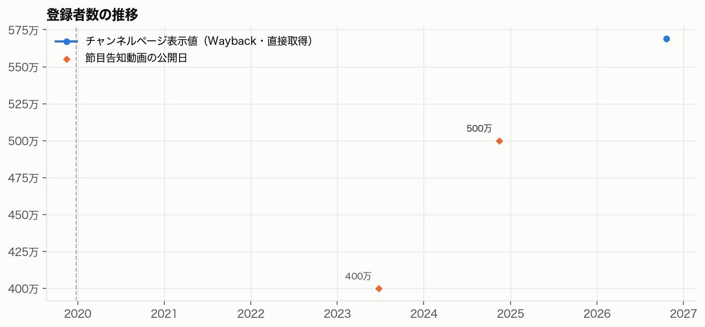
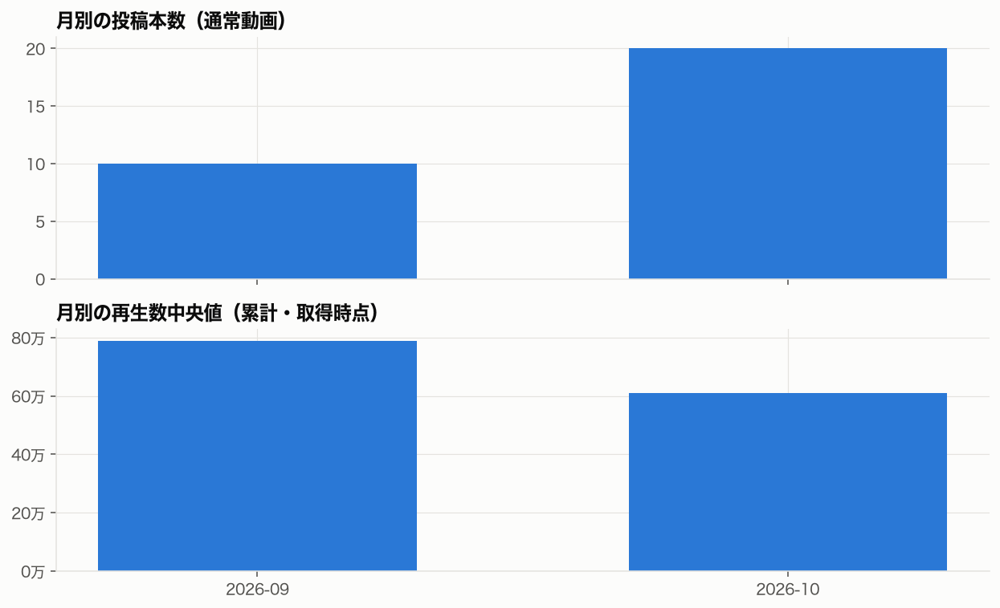
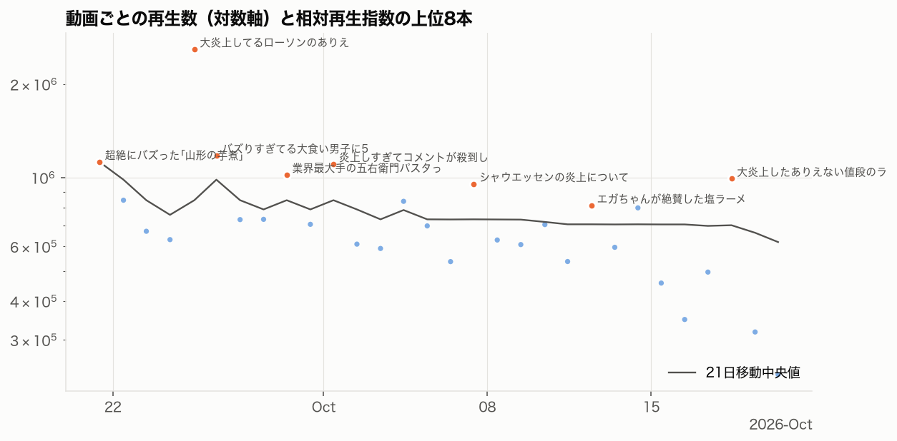
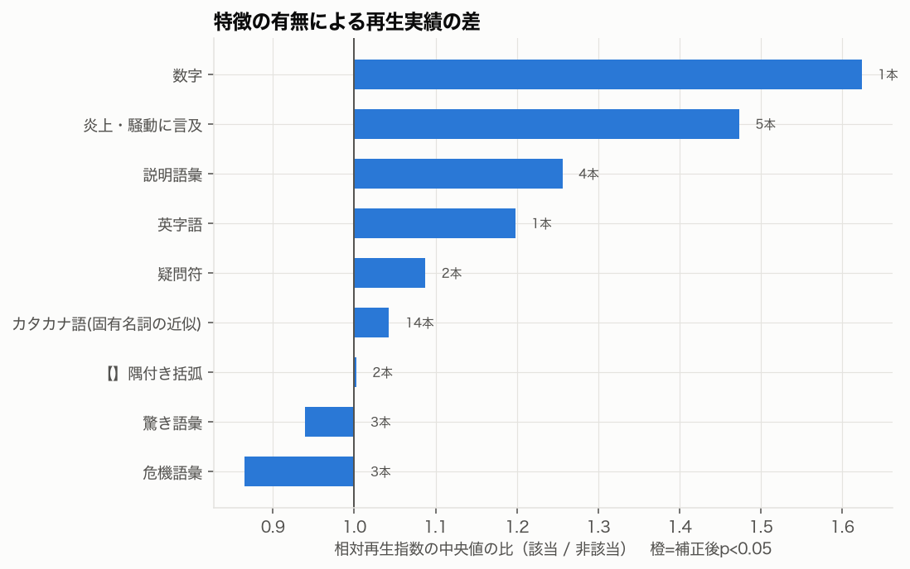
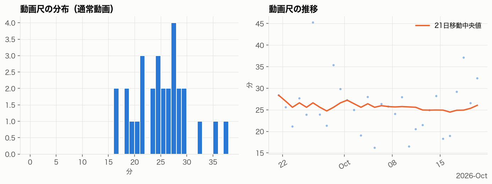
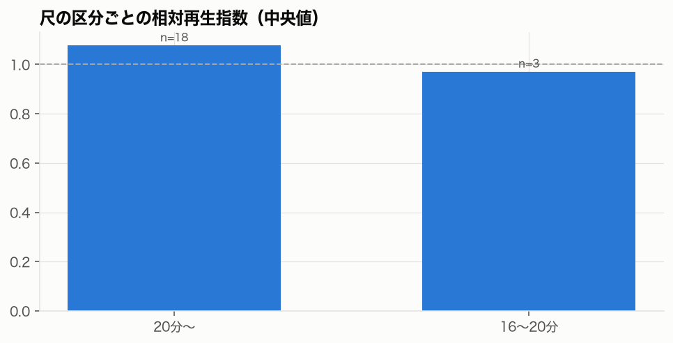
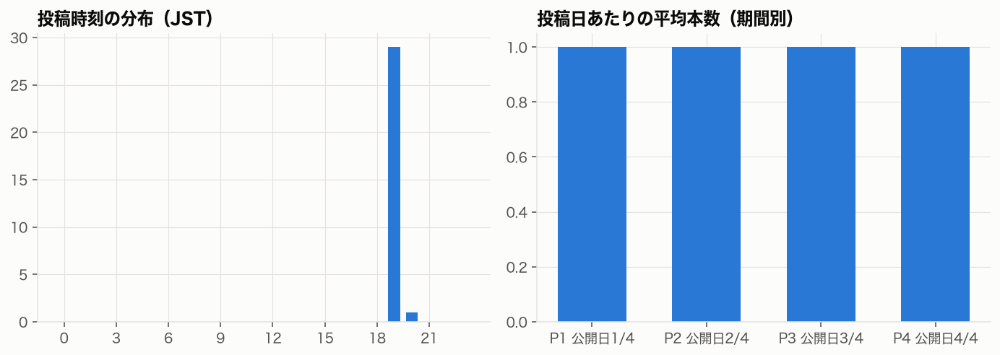

# 料理研究家リュウジのバズレシピ 成長要因調査 報告書（草稿）

- 対象：[料理研究家リュウジのバズレシピ](https://www.youtube.com/@ryuji825)（`UCW01sMEVYQdhcvkrhbxdBpw`）
- データ取得日：2026-10-20
- 方法論バージョン：1.1.0
- 表記：【事実】データで確認できたこと、【推論】データからの解釈、【仮説】公開データで検証しきれないもの
- 自動生成した事実の節と、人間の判断で書く節（「要記入」）がある。要記入の節は methodology/evaluation.md の基準で書く

---

## 1. 調査概要と主要な結論

（要記入：問い・結論の要約・再現可能性の表）

### 自動集計の要点

- 【事実】登録者 5,690,000人、総再生 3,080,009,351回（概要ページ）
- 【事実】取得した動画 79 本（通常 30・Shorts 30・ライブ 19）、各タブ直近 30 本に限定した試験取得
- 【事実】公開期間 2026-09-21〜2026-10-20
- 【事実】再生数の中央値 702,154、最大 2,590,652（最大/中央値 3.7）

## 2. チャンネルの成長過程

相対再生指数の上位5本（公開7日以上）

- [大炎上してるローソンのありえない弁当](https://www.youtube.com/watch?v=UIUf1j5lxMc) 2,590,652回、指数 3.54
- [バズりすぎてる大食い男子に5キロの手料理食わせてみた](https://www.youtube.com/watch?v=jhFTglpMYxw) 1,177,898回、指数 1.61
- [炎上しすぎてコメントが殺到したこれについて](https://www.youtube.com/watch?v=9L3Tvkq6A_0) 1,105,810回、指数 1.57
- [シャウエッセンの炎上について](https://www.youtube.com/watch?v=nxZYS_zpI-E) 954,250回、指数 1.44
- [超絶にバズった｢山形の芋煮｣の作り方。](https://www.youtube.com/watch?v=5_TGUG0pISw) 1,123,263回、指数 1.42

## 3. テーマ・タイトル・サムネイルの分析

テーマ別の集計は phase2_tables.md 3章

（要記入：手作業コーディングの結果と反例。サムネイルは thumbnail_tables.md と一覧画像を確認する）

## 4. 動画尺・投稿戦略の分析

- 【事実】尺の中央値 25.7分
- 詳細は phase2_tables.md 5・6章

## 5. 動画構成・映像表現・ナレーションの分析

（要記入：processed/phase3_sample.csv の代表動画について、字幕と映像を確認した結果）

## 6. 類似チャンネルとの比較

（要記入：選定根拠と比較表。ycanalysis.analyze.peers の出力を使う）

## 7. 成長要因の仮説検証

（要記入：methodology/evaluation.md の仮説表の形式）

### 頑健性チェックの結果

reports/ryuji-buzz-recipe/robustness.md を参照

## 8. 他チャンネルでも再現可能な制作手法

（要記入）

## 9. 分析の限界と未検証事項

- 視聴維持率・CTR・トラフィック元・登録転換率は公開データにない
- 登録者数の過去値は Wayback の保存状況に依存する（観測点 1 件）
- 試験取得のため、直近の動画だけで集計している。期間・テーマの比較は全動画の取得後に行う
