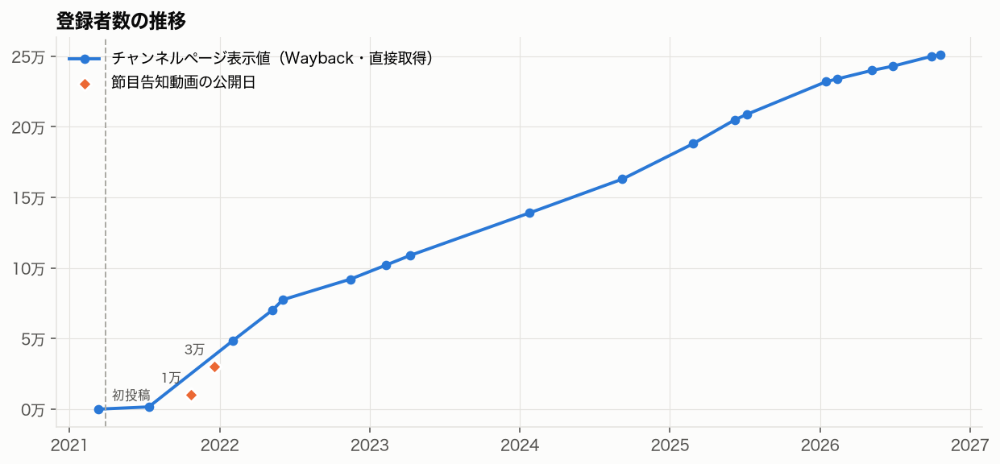
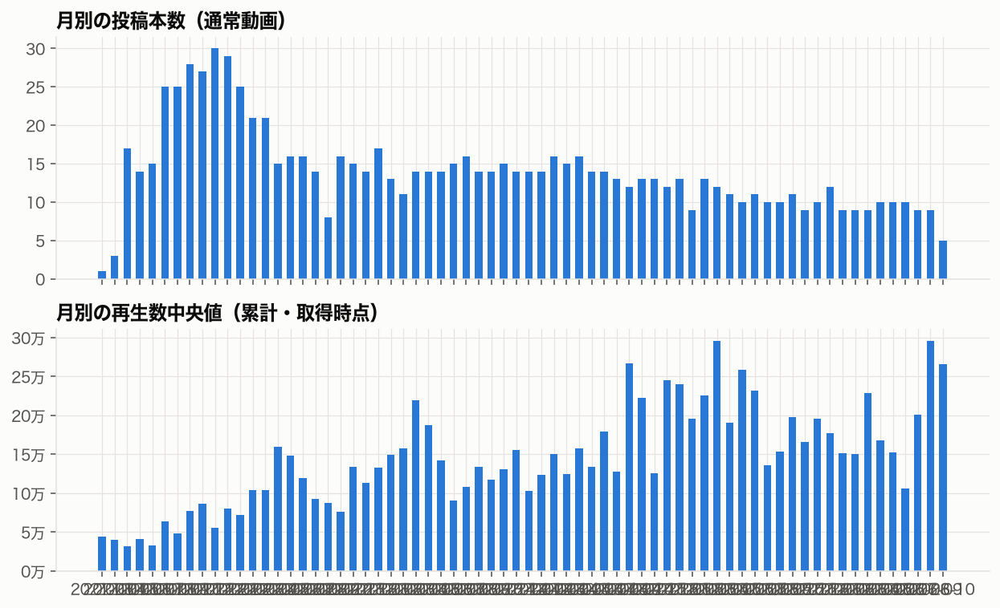
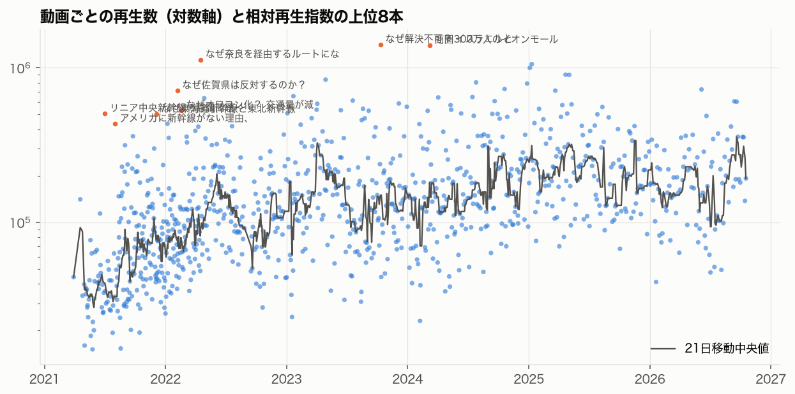
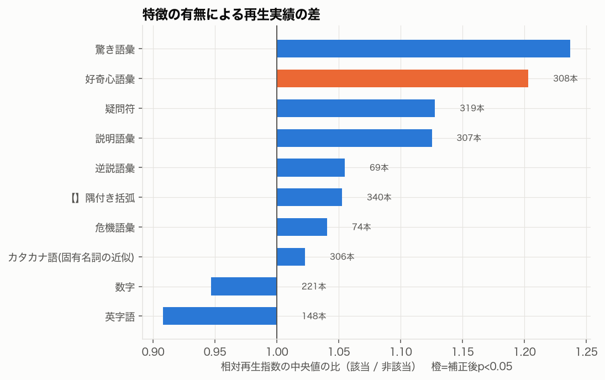
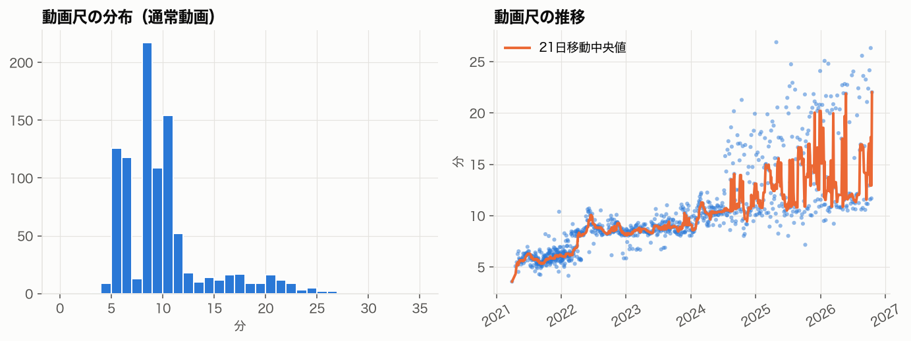
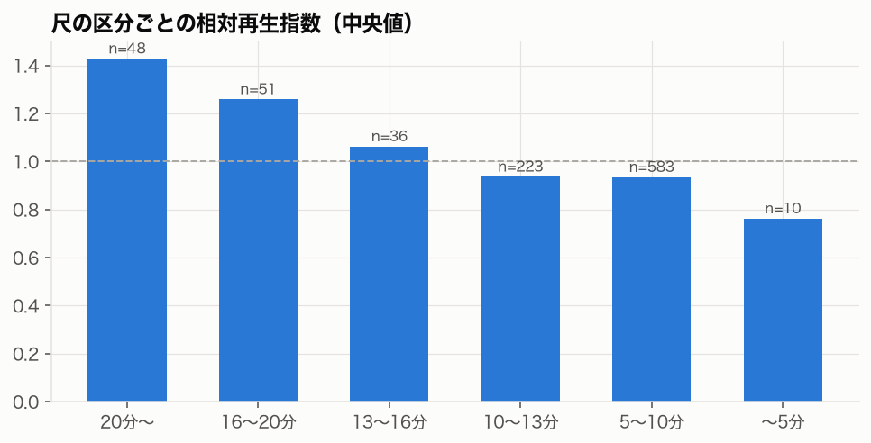
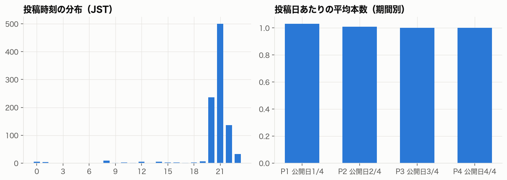

# たくみっく 成長要因調査 報告書（草稿）

- 対象：[たくみっく](https://www.youtube.com/@upunushi-ossan)（`UC21f1t3X_sYMD28XclLNpUw`）
- データ取得日：2026-10-20
- 方法論バージョン：1.3.0
- 表記：【事実】データで確認できたこと、【推論】データからの解釈、【仮説】公開データで検証しきれないもの
- 自動生成した事実の節と、人間の判断で書く節（「要記入」）がある。要記入の節は methodology/evaluation.md の基準で書く

---

## 1. 調査概要と主要な結論

（要記入：問い・結論の要約・再現可能性の表）

### 自動集計の要点

- 【事実】登録者 251,000人、総再生 163,890,546回（概要ページ）
- 【事実】取得した動画 957 本（通常 953・Shorts 4・ライブ 0）
- 【事実】公開期間 2021-03-29〜2026-10-17
- 【事実】再生数の中央値 124,385、最大 1,411,632（最大/中央値 11.3）

## 2. チャンネルの成長過程

相対再生指数の上位5本（公開7日以上）

- [リニア中央新幹線の静岡問題～小学生でもわかるように解説](https://www.youtube.com/watch?v=fBB8CFP5YsA) 504,572回、指数 13.79
- [なぜ解決不可？ イスラエルとパレスチナ問題を超わかりやすく説明。](https://www.youtube.com/watch?v=XoOlrKOKMQE) 1,411,632回、指数 11.52
- [【リニア】なぜ奈良を経由するルートになった？ （リニア中央新幹線）](https://www.youtube.com/watch?v=gG4IJt0WoWA) 1,126,458回、指数 10.56
- [【なぜ？】アメリカに新幹線がない理由、小学生でもわかるように解説](https://www.youtube.com/watch?v=_vXBixL9hGM) 433,362回、指数 10.29
- [【西九州新幹線】なぜ佐賀県は反対するのか？ 小学生でもわかるように解説（長崎本線の並行在来線問題）](https://www.youtube.com/watch?v=9q9WMQ7gF7A) 710,466回、指数 10.17

## 3. テーマ・タイトル・サムネイルの分析

テーマ別の集計は phase2_tables.md 3章

（要記入：手作業コーディングの結果と反例。サムネイルは thumbnail_tables.md と一覧画像を確認する）

## 4. 動画尺・投稿戦略の分析

- 【事実】尺の中央値 8.9分
- 詳細は phase2_tables.md 5・6章

## 5. 動画構成・映像表現・ナレーションの分析

（要記入：processed/phase3_sample.csv の代表動画について、字幕と映像を確認した結果）

## 6. 類似チャンネルとの比較

（要記入：選定根拠と比較表。ycanalysis.analyze.peers の出力を使う）

## 7. 成長要因の仮説検証

（要記入：methodology/evaluation.md の仮説表の形式）

### 頑健性チェックの結果

reports/upunushi-ossan/robustness.md を参照

## 8. 他チャンネルでも再現可能な制作手法

（要記入）

## 9. 分析の限界と未検証事項

- 視聴維持率・CTR・トラフィック元・登録転換率は公開データにない
- 登録者数の過去値は Wayback の保存状況に依存する（観測点 19 件）
