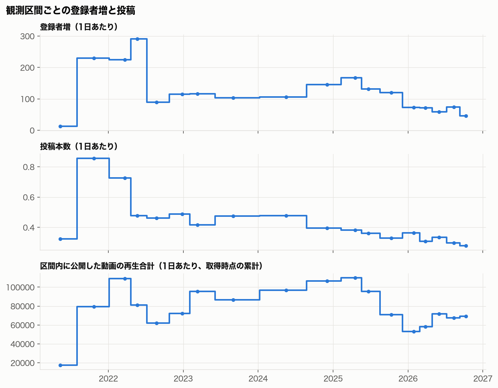
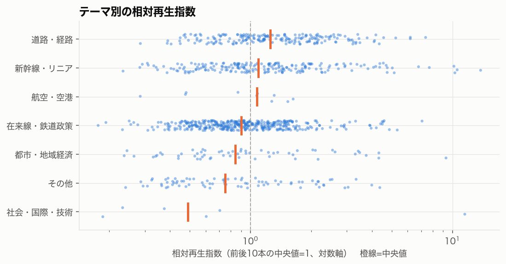
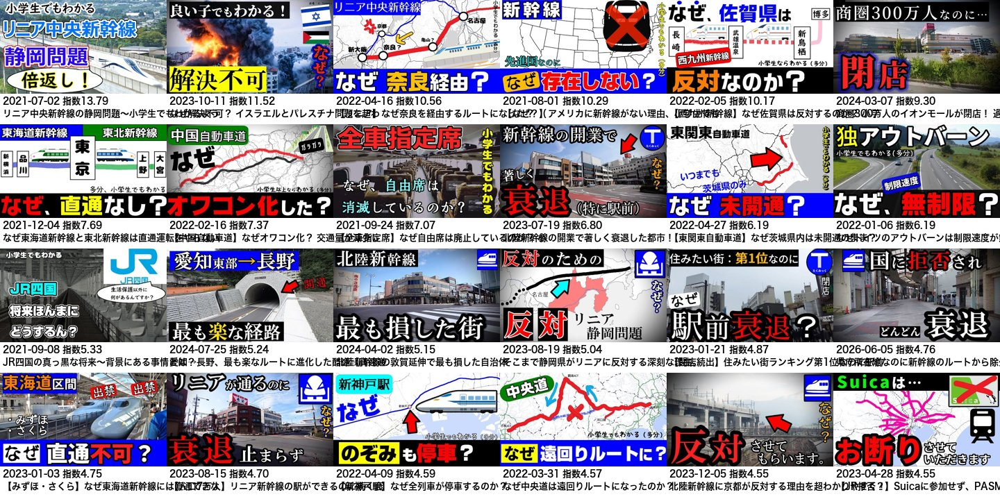
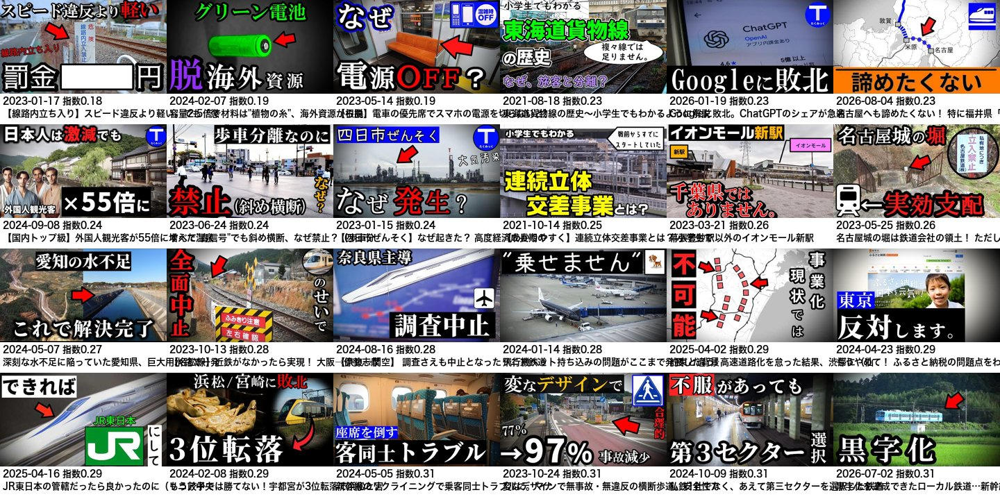
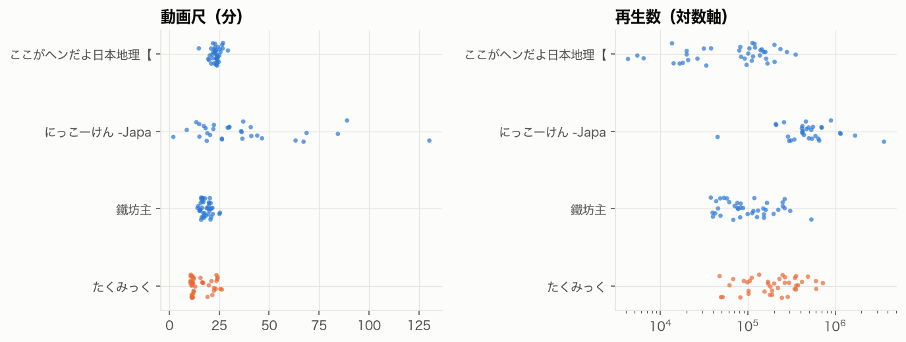
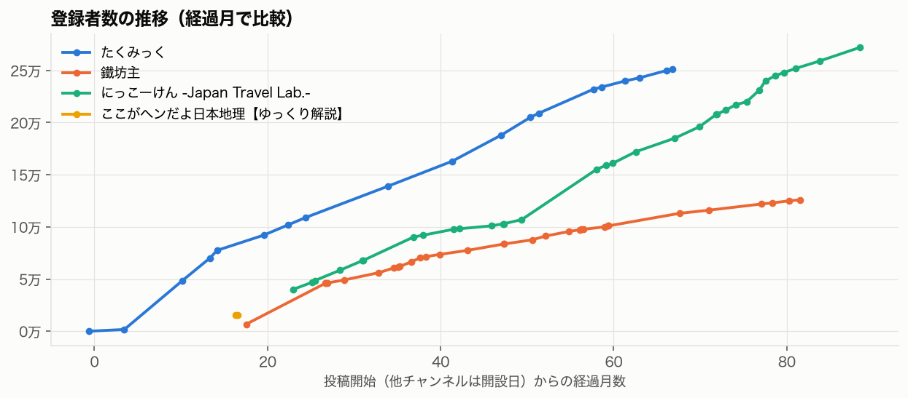

# たくみっく 成長要因調査 報告書

- 対象：[たくみっく](https://www.youtube.com/@upunushi-ossan)（`UC21f1t3X_sYMD28XclLNpUw`）
- データ取得日：2026-10-20（動画957本、概要ページ、Wayback 18点）、比較・検証は 2026-10-21
- 方法論バージョン：1.3.0
- 表記：【事実】データで確認できたこと、【推論】データからの解釈、【仮説】公開データで検証しきれないもの
- 詳細：[hypotheses.md](hypotheses.md)・[hypothesis_tests.md](hypothesis_tests.md)・[phase2_tables.md](phase2_tables.md)・[phase4_tables.md](phase4_tables.md)・[robustness.md](robustness.md)・[データ監査](../../data/upunushi-ossan/processed/subscriber_audit.csv)
- 修正前の報告書（2026-10-20、登録者17,700人・505本・考察の章が空欄）は [archive/FINAL_REPORT-20261020-incomplete.md](archive/FINAL_REPORT-20261020-incomplete.md) に保全

---

## 1. 調査概要と主要な結論

### 問い

- 急伸期（2021年後半〜2022年前半）に、何が登録者を集めたのか
- 1本あたりの再生は伸びているのに、2025年後半から登録者の伸びが鈍化しているのはなぜか
- 動画ごとの再生の差を説明する題材・形式は何か

### 結論

| # | 結論 | 確信度 | 他チャンネルでの再現可能性 |
|---|---|---|---|
| 1 | 【推論】登録者の増え方は、1本あたりの再生ではなく、投稿本数と新規動画の再生合計に連動している（区間17、ρ=0.69・0.73） | 中 | 中 |
| 2 | 【推論】急伸期は「〜小学生でもわかるように解説」の5〜6分の解説をほぼ毎日（1日0.86本）出した時期で、1,000再生あたりの登録者増も全期間で最高（2.9人） | 低〜中 | 中 |
| 3 | 【推論】2026年の鈍化は投稿頻度の低下（1日0.3本前後）と新規動画の再生合計の減少で説明でき、走行型・長尺への移行だけでは説明できない | 中 | — |
| 4 | 【事実】新規開通・短縮ルートの回は、標本外の検証で相対再生指数が1.49倍（131本、事前登録、4指標で一貫） | 高 | 高 |
| 5 | 【事実】「なぜ」「理由」で因果を問うタイトルは1.18倍（288本、同上）。サムネイルでも上位24本の17本が「なぜ〇〇？」 | 中 | 高 |
| 6 | 【事実】内容分析の標本で目立った「地域の損得を問う題材」は、標本外では差がなかった（0.97倍、121本） | 棄却 | — |

- 【事実】登録者は一度も減っていない。旧版の「17,700人」はおすすめ欄の別チャンネル（「社会のさと」、別ID）の値で、修正後の現在値は 251,000人（25.1万人、YouTube の対象IDの構造化データ）
- 【事実】話し方・構成・映像の型（問い → 経緯 → 「うp主のおっさん」の台詞 → 駄洒落の締め、現地映像と白地図）は高・中・低の全群で共通しており、動画間の差を生んでいない

## 2. チャンネルの成長過程

### 登録者数のデータ品質

- 【事実】現在値：概要ページの `subscriberCountText`（対象IDのノード）が `251K subscribers`。表示は千人単位の丸め
- 【事実】外部情報源：vidIQ（URLのチャンネルIDで同一性を確認）の 2025-06-03 時点 20.5万人は、Wayback の 2025-06-07 の観測値 205,000人と一致。ユーチュラの 251,000人（Codex が 2026-10-20 に記録）は 403 で再確認できず、照合に使っていない
- 【事実】過去値：Wayback 18点と概要ページ1点の計19観測すべてを、対象IDのノードまたは対象IDを持ち主とするページのヘッダーから読み、無効0・疑義0
- 【事実】誤取得の原因：旧処理はHTML全体で最初に見つかった登録者数を採用していた。2026-10-20 の概要ページでは、最初に現れるのがおすすめ欄「社会のさと」（`UC5ifJ1NPyzl-52NPvrOWAlQ`）の 17.7K だった

| 日付 | 旧値（誤） | 修正値 |
|---|---:|---:|
| 2022-02-01 | 1,750 | 48,500 |
| 2023-04-10 | 15,600 | 109,000 |
| 2025-02-25 | 18,400 | 188,000 |
| 2026-09-29 | 17,700 | 250,000 |
| 2026-10-20 | 17,700 | 251,000 |

- 【事実】もう一つの欠落：旧版は動画の取得が957本中505本で中断しており、2021年3月〜9月の動画（急伸期の前半）を含んでいなかった。今回、全957本を取得した

### 三つの局面

| 区間 | 1日あたり登録者増 | 投稿（1日あたり） | 区間内公開動画の再生（1日あたり） | 1,000再生あたり登録者増 |
|---|---:|---:|---:|---:|
| 2021-03〜07 | 13 | 0.32 | 17,461 | 0.75 |
| **2021-07〜2022-02** | **229** | **0.86** | 79,398 | **2.89** |
| 2022-02〜05 | 225 | 0.73 | 108,922 | 2.06 |
| 2022-06〜11 | 89 | 0.46 | 62,048 | 1.43 |
| 2023-04〜2024-01 | 104 | 0.47 | 86,487 | 1.20 |
| 2024-09〜2025-02 | 146 | 0.40 | 106,662 | 1.37 |
| 2025-02〜06 | 167 | 0.38 | 109,836 | 1.52 |
| 2025-07〜2026-01 | 120 | 0.33 | 70,998 | 1.69 |
| 2026-02〜05 | 71 | 0.31 | 58,058 | 1.23 |
| 2026-06〜09 | 74 | 0.30 | 67,317 | 1.11 |

- 区間内公開動画の再生は、取得時点の累計を区間の日数で割った近似値（古い区間ほど長く再生を蓄積している）
- 【事実】1日あたり登録者増は、投稿頻度と ρ=0.69（p=0.002）、区間内公開動画の再生合計と ρ=0.73（p=0.001）、1本あたりの再生中央値と ρ=0.10（p=0.69）
- 【推論】1本あたりの再生（中央値 2021年 5.2万回 → 2025年 21.8万回）が伸びても、本数が減ると新規動画の再生総量が増えず、登録者の伸びが鈍る
- 【事実】2022年6月に投稿が1日0.73本から0.48本に減った区間で、登録者増も1日225人から89人に下がった

### 急伸期の動画

- 【事実】2021年の動画185本のうち88%が「〜小学生でもわかるように解説」の型（尺の中央値5.8分）。2023年以降は使われていない
- 【事実】急伸期の上位：[なぜ東海道新幹線と東北新幹線は直通運転をやらないのか？](https://www.youtube.com/watch?v=ai7c76N7fsQ)・[なぜドイツのアウトバーンは制限速度が無制限なのか？](https://www.youtube.com/watch?v=Uxtu1CBOXNY) など、「なぜ」で始まる新幹線・道路の素朴な疑問
- 【事実】チャンネル全体で相対再生指数が最も高い動画は [リニア中央新幹線の静岡問題～小学生でもわかるように解説](https://www.youtube.com/watch?v=fBB8CFP5YsA)（2021-07-02、50万回、指数13.8）で、急伸期の直前に公開されている

## 3. テーマ・タイトル・サムネイルの分析

### テーマ

- 分類：設定 `[theme_rules]` の規則 v2。再生数を伏せた抜き取り100本（規則の改訂に使っていない標本）との一致 κ=0.66、一致率0.76。v1（Codex 作成）は同じ標本で κ=0.51 だったため改訂した（[コードブック](../../docs/upunushi-ossan-codebook.md)）

| テーマ | 本数 | 相対指数中央値 | 回帰（基準：在来線） |
|---|---:|---:|---|
| 道路・経路 | 204 | 1.25 | 1.23倍（p=0.004） |
| 新幹線・リニア | 203 | 1.09 | 1.33倍（p<0.001） |
| 在来線・鉄道政策 | 391 | 0.90 | 基準 |
| 都市・地域経済 | 58 | 0.84 | 1.03倍（p=0.81） |
| その他 | 79 | 0.75 | 0.88倍（p=0.13） |

- 【事実】道路の比率は公開日の4等分で 5% → 10% → 17% → 44% と増えた。新幹線・リニアは前半ほど強く（P1 1.77 → P4 0.80）、道路は中盤以降に強い（P2 1.56・P3 1.60）

### 事前登録した仮説の標本外検証

代表36本の字幕を読んだ後、全957本の取得が終わる前に、判定規則と予想の向きを設定ファイルに登録し、代表36本を除いた915本で検証した（[hypothesis_tests.md](hypothesis_tests.md)）

| 仮説 | 該当 | 中央値の比 | 補正後p | 判定 |
|---|---:|---:|---:|---|
| 新規開通・短縮ルート | 131 | 1.49 | <0.001 | 支持 |
| 「なぜ」「理由」で因果を問う | 288 | 1.18 | <0.001 | 支持 |
| 地域・事業者の得失を問う | 121 | 0.97 | 0.59 | 不支持 |
| 仮定・妄想 | 13 | 1.07 | 0.59 | 不支持（少数） |
| 交通以外の話題 | 4 | 0.40 | — | 検定不能 |

- 【事実】支持された2件は、相対指数の近傍5・10・20本と、経過日数・公開月で調整した残差の4指標すべてで p<0.002
- 例：[埼玉→山梨、開通で大幅にショートカット](https://www.youtube.com/watch?v=dTctM-nn-dg)（100万回、指数4.18）、[いわき→那須塩原、遂に開通した無料の高速道路](https://www.youtube.com/watch?v=muyhHiMERi4)（48万回、3.48）
- 反例：[東京→成田空港、開通で最短ルートへ](https://www.youtube.com/watch?v=kdsRrTPqvFs)（指数0.96）

### タイトル要素

- 【事実】好奇心語彙（なぜ・理由など）1.20倍（補正後 p=0.001）、疑問符は回帰で1.21倍（p=0.001）。数字・【】・文字数は差なし
- 【事実】直近40本では疑問符の使用が2.5%まで減っている（[phase4_tables.md](phase4_tables.md)）

### サムネイル

- 【事実】目視で、サムネ文字に「なぜ」がある割合は上位24本で17本、下位24本で3本（`annotations/thumbnail_codes.csv`）
- 【事実】上位は白地図に赤い路線と「なぜ 〇〇？」の帯、下位は写真に短い名詞（「調査中止」「黒字化」）が多い
- 【事実】明度は上位が高い（補正後 p=0.001）が、白地図を使う初期の動画が上位に多く、時期と分けられない

## 4. 動画尺・投稿戦略の分析

- 【事実】尺の中央値は 2021年5.8分 → 2025年13.1分。区分別では20分以上が1.43、5〜10分が0.93（Kruskal-Wallis p<0.001）、回帰で1分あたり1.06倍（p<0.001）、4指標で一貫（ρ=0.13〜0.17）
- 【推論】長尺の多くは道路の走行回で、題材の効果と重なる
- 【事実】投稿は毎日20〜22時台、1日2本の日は957本中9日だけ
- 【事実】金・土曜は単純比較で高い（1.17・1.16 対 月・水 0.88・0.87）が、道路の回が金・土曜に多く（33%、他16%）、テーマ・尺・期間を調整すると1.09倍（p=0.08）

## 5. 動画構成・映像表現・ナレーションの分析

### 方法

- 代表36本（相対指数の上位・中位・下位から各12本、`annotations/phase3_sample_frozen.csv`）の字幕全文の要約と、15秒ごとの映像フレームをすべて目視（[コーディング結果](../../data/upunushi-ossan/annotations/phase3_coding.csv)）
- 映像は360pで一時取得し、フレームとカット時刻だけを残して削除

### 共通の型

| 区間 | 内容 |
|---|---|
| 0:00〜0:30 | 「なぜ〇〇なのか」「〇〇が閉店」など問いや出来事を提示し、「皆さん、おいなんで〜だよと思ったかもしれません」と視聴者の疑問を代弁 |
| 0:30〜 | 「どんな事情があるのか見ていきましょう」で経緯へ。歴史・行政・事業者の判断を時系列で説明 |
| 本編 | 「うp主のおっさん」の台詞（関西弁・方言・上から目線の評価）にナレーターがツッコむ掛け合い |
| 終盤 | 「皆さんは何かコメントありますか」→「おっさんはこう言い残しました」→ 駄洒落（例：「これが本当の名勝負」） |

- 走行型は、起点から終点まで区間ごとに道路の構造（信号・立体交差・車線）を評価し、最後にイオンモールでコーヒーの「食レポ」をする定型がある
- 例：[【リニア】なぜ奈良を経由するルートになった？](https://www.youtube.com/watch?v=gG4IJt0WoWA)（指数10.6）0:00 奈良経由への疑問 → 0:40 田中角栄の整備計画 → 3:00 JR東海の決定 → 4:00 京都ルートより短い理由 → 5:00 県内の駅をめぐる争い → 7:30 駄洒落

### 群間比較

| 項目 | 高（12） | 中（12） | 低（12） |
|---|---:|---:|---:|
| 解説型 / 走行型 | 8 / 4 | 5 / 5 | 4 / 1 |
| 仮定型・時事外・反応型・論争型 | 0 | 2 | 7 |
| 新規開通の情報 | 5 | 1 | 0 |
| 地域の得失を問う | 6 | 4 | 2 |
| 自分で撮った現地映像が多い | 9 | 8 | 3 |
| 駄洒落の締め | 10 | 10 | 6 |
| 話速（字幕、毎分） | 約328字 | 約324字 | 約326字 |

- 【事実】映像は全群とも、自分で撮った現地・車窓映像、白地図に赤い路線、平面的なアイコン図解、青枠のテロップ、常時字幕の組み合わせ
- 【事実】低位群で現地映像が少ない回は、交通以外の題材（[ペットの機内持ち込み](https://www.youtube.com/watch?v=xzMbx99qUR8)、[植物由来の電池](https://www.youtube.com/watch?v=LMNZivPCSK4)、[ChatGPTのシェア](https://www.youtube.com/watch?v=38bM5by-z5g)）で、素材画像が中心
- 【推論】型は全群に共通するため差を生む要因ではない。差は題材（開通・「なぜ」）と、型から外れた回（仮定・論争・時事外）の不振に表れる
- 【事実】「地域の得失」は標本内では高位群に多かったが、標本外では差がなく（3章）、同じ得失の題材でも [超赤字に転落した三セク鉄道](https://www.youtube.com/watch?v=iZS8nxFtqqQ)（0.99）、[リニアが開業したら廃止になりそうな鉄道](https://www.youtube.com/watch?v=o5SBErJD8z4)（0.35）は伸びていない

## 6. 類似チャンネルとの比較

### 選定

- 交通・地域の4語（「新幹線 路線 解説」「高速道路 開通 解説」「鉄道 廃線 地方都市 解説」「道路 走行 地図 解説」）の YouTube 検索上位20件から、複数の検索語または上位に出た個人の解説チャンネルを選んだ
- 報道機関・公式（NEXCO中日本・MBS・鉄道運輸機構）と、規模の小さいチャンネルは除外した
- 選定理由：鐵坊主は2つの検索語に6本出現し、都市と鉄道の構造解説という最も近い題材。にっこーけんは2つの検索語に出現し、車載映像の走行企画という形式が近い。ここがヘンだよ日本地理は「廃線」の検索で1位、ゆっくり解説の「N選」形式で地域の衰退を扱う
- 比較可能な範囲：各チャンネルの直近40本（公開7日以上）。開設時期（2019〜2025年）、規模（1.6万〜27.2万人）、投稿頻度が大きく違うため、数値は傾向の比較に留める

| 指標 | たくみっく | 鐵坊主 | にっこーけん | ここがヘンだよ日本地理 |
|---|---|---|---|---|
| 登録者 | 25.1万 | 12.6万 | 27.2万 | 1.58万 |
| 開設 | 2021-02 | 2020-01 | 2019-06 | 2025-06 |
| 週あたり投稿 | 2.2 | 1.0 | 0.2 | 2.1 |
| 尺中央値 | 12.1分 | 17.7分 | 29.8分 | 23.5分 |
| 再生中央値 | 19.5万 | 8.8万 | 47.1万 | 9.9万 |
| 最大／中央値 | 3.7 | 6.1 | 7.7 | 3.6 |
| 高評価率 | 0.98% | 1.50% | 1.89% | 0.54% |
| コメント率 | 0.13% | 0.41% | 0.10% | 0.09% |
| 話し手 | 1人の語り＋「おっさん」の台詞 | 1人の落ち着いた語り | 合成音声2人の掛け合い | ゆっくり2人の掛け合い |
| 映像 | 自分で撮った現地・車窓、白地図 | 現地映像、衛星地図、統計パネル | 車載映像、キャラクター | 写真スライド |
| 登録者の推移 | 2025-02 18.8万 → 2026-10 25.1万 | 2023-01 6.6万 → 2026-10 12.6万 | 2025-01 18.5万 → 2026-10 27.2万 | 2026-10 1.58万（観測1点） |

- 各チャンネル3本（直近40本の再生上位・中央・下位）の字幕と映像を確認した。にっこーけんの下位はメンバーシップの告知（2分）で、内容の比較には使っていない
- 【事実】ジャンル共通：地域の衰退・廃線・格差の題材（3件とも）、地図と現地写真、常時字幕、「なぜ」の問い
- 【事実】たくみっく固有：12分前後の短めの尺、週2本超の投稿、自分で運転した車窓映像、「うp主のおっさん」の人物を三人称で語らせる掛け合いと駄洒落の締め
- 【推論】にっこーけんは週0.2本で1日約140人増えており、少数の大型企画（再生中央値47万回、最大は362万回）で成長する別の経路がある。たくみっくの成長は本数の積み上げ型で、投稿頻度の低下がそのまま伸びの鈍化に表れやすい構造と考えられる

## 7. 成長要因の仮説検証

各仮説の支持・反証・代替説明・確信度・再現可能性は [hypotheses.md](hypotheses.md)。ここでは4段階に整理する

### 発見される要因

- G1 投稿本数と新規動画の再生合計が登録者の増え方に連動（確信度：中）
- H2 新規開通・短縮ルートの情報は再生が高い（高）。開通は検索需要と時事性を持つ
- 【仮説】推薦・検索のどちらが効いているかは、トラフィック元が公開データにないため検証できない

### クリックされる要因

- H5 「なぜ」「理由」の問い（中）。サムネイルでも「なぜ〇〇？」が上位に多い
- テーマは新幹線・リニアと道路が強く、在来線・地域・その他は弱い（回帰で1.23〜1.33倍）
- H1 地域の得失の題材は棄却。ジャンル共通の題材で、差を生まない

### 視聴が継続される要因

- F1 型（問い → 経緯 → 掛け合い → 駄洒落）は全群に共通し、差を生まない（中）
- 長尺ほど相対指数が高い（1分あたり1.06倍）が、走行型と重なる。視聴維持率は公開データにない
- V1 現地映像の多さは標本内では高位に多いが、交通以外の題材と重なる（低）

### 再訪・登録につながる要因

- G2 急伸期の毎日投稿と短い「なぜ」解説（低〜中）。1,000再生あたりの登録者増は急伸期が2.9人で最高
- G3 2026年の鈍化は投稿頻度の低下と新規動画の再生減少で説明できる（中）。走行型・長尺への移行は2024〜2025年の成長期にも起きており、単独の原因ではない（低）
- 【仮説】登録転換率・再訪率は公開データにないため、どの動画が登録を生んだかは直接は分からない

## 8. 他チャンネルでも再現可能な制作手法

- 新しくできたもの（開通した道路・新駅・新路線）を実際に使い、従来との違いを数字（短縮時間・信号の数）で伝える企画は、ジャンル内で再現しやすく、効果も標本外で確認できた
- タイトルとサムネイルで「なぜ〇〇なのか」を一つだけ問う。用語の説明（「〇〇とは」）より、具体的な事例の理由を問う形が強い
- 登録者を増やす局面では、1本の完成度を上げるより、一定の品質で本数を保つ方が効く可能性がある（このチャンネルでは本数と登録者増が連動）。ただし少数の大型企画で伸びる例（にっこーけん）もあり、どちらを選ぶかは制作体制で決める
- 型（問い → 経緯 → 人物の台詞 → 締めの定型）を固定し、題材の選定に労力を回す。型から外れた回（仮定・論争・ジャンル外）は伸びにくい
- 再現が難しいもの：「うp主のおっさん」という人物像と掛け合いの語り口、5年間で957本を作った制作量

## 9. 分析の限界と未検証事項

- 視聴維持率・CTR・トラフィック元・登録転換率は公開データにない。発見・継続・登録の段階の要因は間接的な証拠に留まる
- 登録者の観測点は19（2021年は2点）で、区間ごとの比較は17区間の相関に基づく。投稿頻度と登録者増がどちらも時間とともに下がる傾向を除いた分析はしていない
- 区間内公開動画の再生は、取得時点の累計を使った近似で、区間ごとの実際の再生量ではない
- テーマの規則分類は κ=0.66 で、判定者は分析エージェント1名。新幹線と地域の両方を扱う動画で不一致が残り、未分類が8%ある
- 内容分析の標本は 2026-10-20 に505本のデータで選んだもので、全957本で選び直していない（標本外の検証からは除外している）
- 仮説の事前登録は、代表36本を読み、旧データ（505本）の集計を見た後に行った。規則と向きは標本外の結果を見る前に固定したが、完全に独立な事前登録ではない
- 外部情報源で現在値を独立に照合できていない（ユーチュラは再確認できず、vidIQ は過去値のみ）
- 比較チャンネルは直近40本と各3本の内容確認で、成長初期の動画は見ていない
